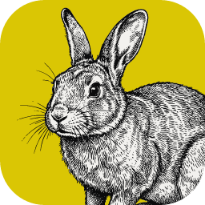
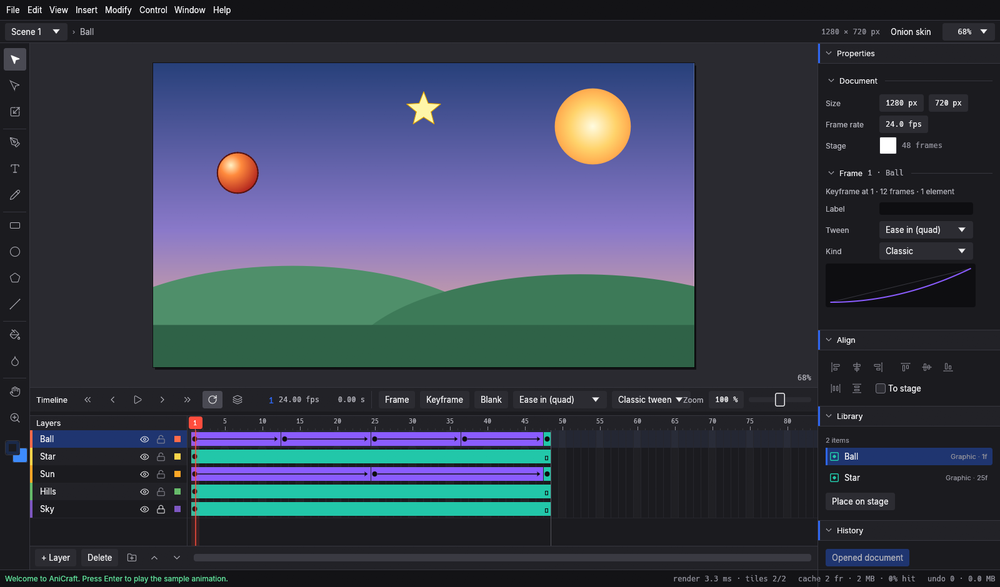
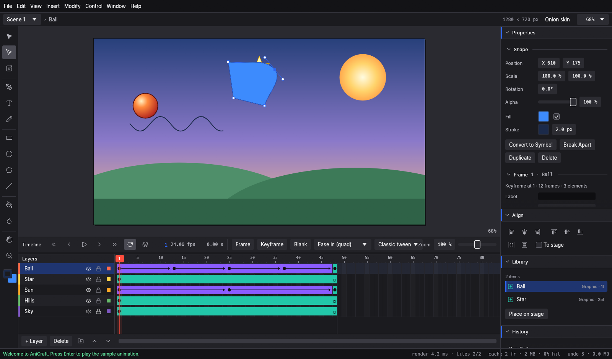
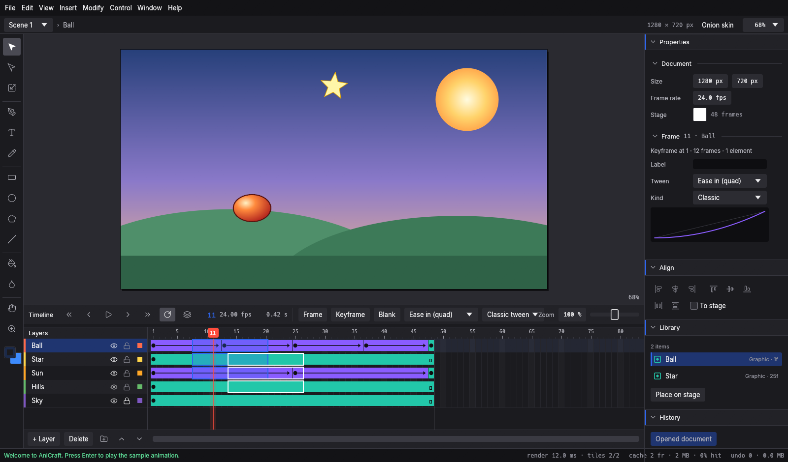
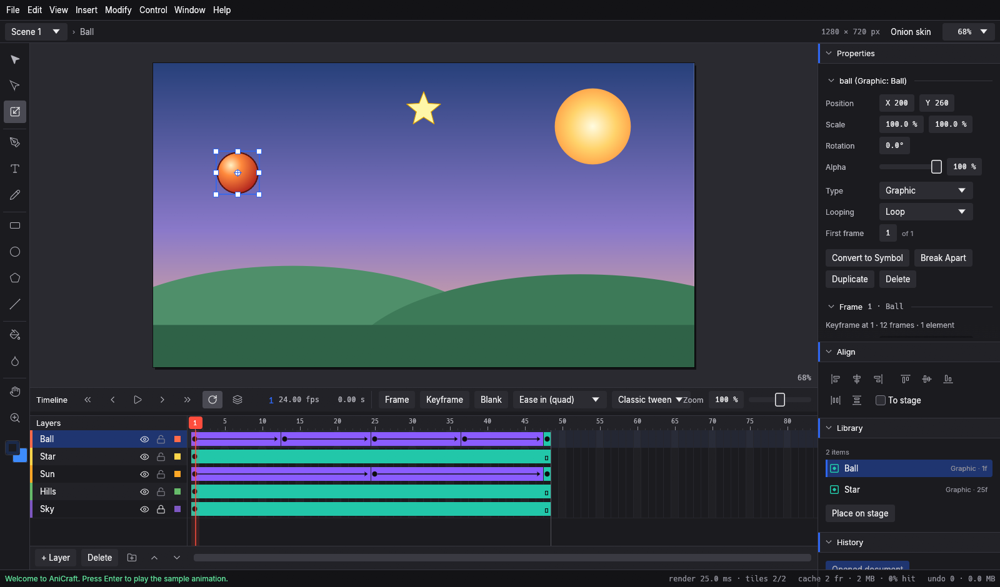
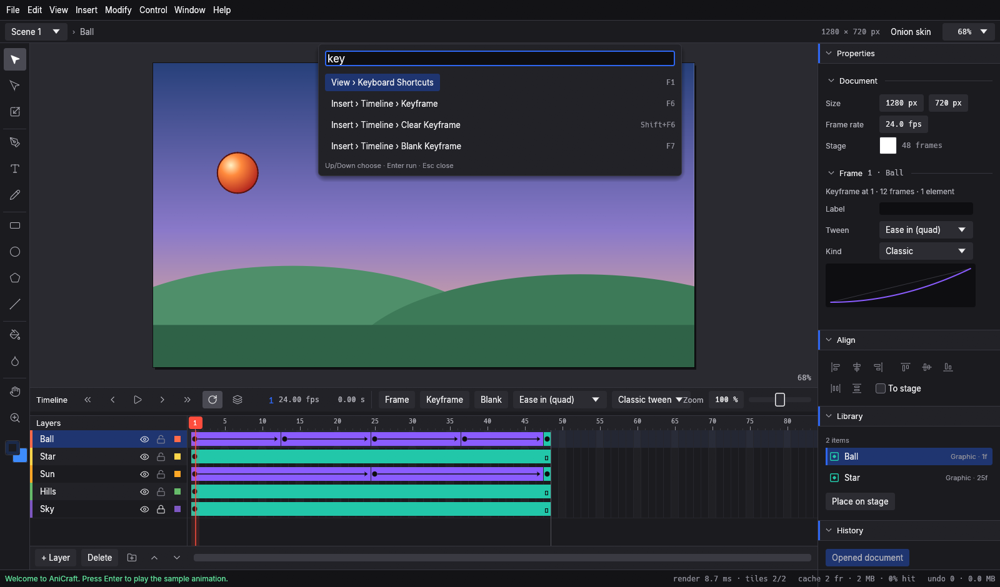
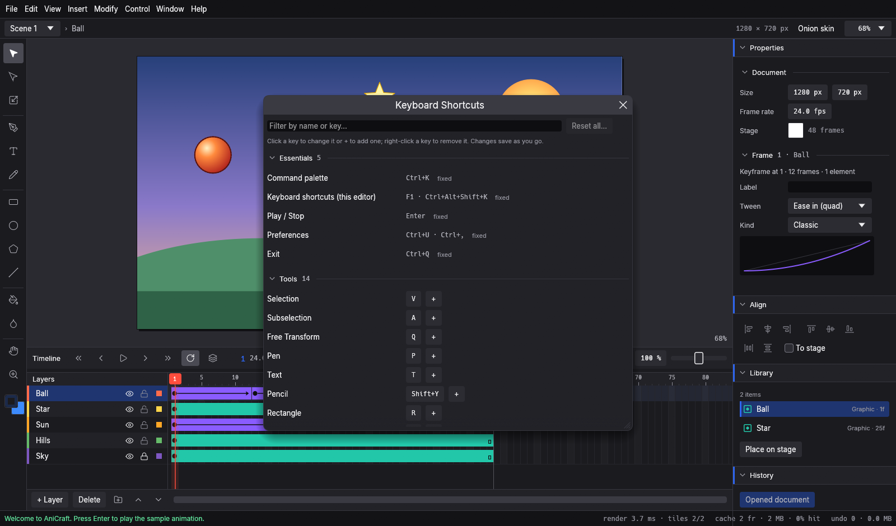
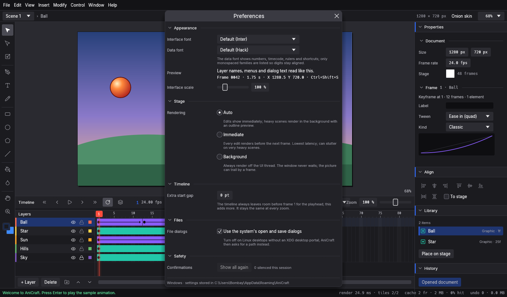
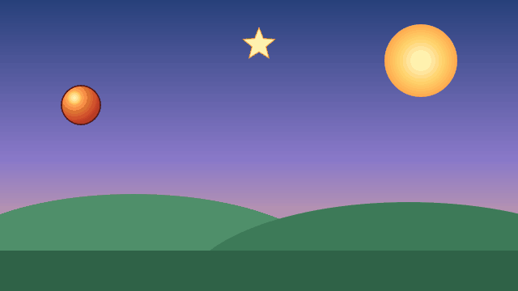
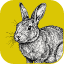

<p align="center">
  <a href="https://getartcraft.com/">
    <picture>
      <source media="(prefers-color-scheme: dark)" srcset="docs/brand/artcraft-logo-white.svg">
      
    </picture>
  </a>
</p>


<p align="center">
  
</p>

<h1 align="center">AniCraft</h1>

<p align="center">
  <b>2D vector animation studio; an open-source, clean-room reimplementation of Adobe Animate, rebuilt in pure Rust.</b>
</p>

<p align="center">
  A native 2D vector animation editor with timeline, layers, keyframes, classic and shape tweens,
  onion skinning, and an egui stage. It runs natively on macOS, Windows, Linux and FreeBSD,
  and in the browser via WebAssembly. Built by the ArtCraft team.
</p>

<p align="center">
  
  
  
  
  
  <br>
  <a href="https://sonarcloud.io/project/overview?id=storytold_anicraft"></a>
  <a href="https://coderabbit.ai"></a>
</p>

<p align="center">
  <a href="https://discord.gg/artcraft"></a>
</p>

<p align="center">
  <a href="https://getartcraft.com/apps/anicraft"><b>AniCraft on getartcraft.com</b></a> ·
  <a href="https://getartcraft.com/">ArtCraft</a> ·
  <a href="https://getartcraft.com/apps">All Crafting Apps</a>
</p>

<br>

<p align="center">
  
  <br><sub><b>The sample animation</b>: stage, tools, timeline with classic tweens, and Properties with the easing curve · <code>cargo run</code></sub>
</p>

> [!NOTE]
> **ArtCraft is a community of artists from all walks of life.** Painters, animators, filmmakers,
> illustrators, game makers &mdash; if you make things, you're one of us. **[Come say hi on Discord](https://discord.gg/artcraft).**

<p align="center">
  <a href="#a-look-around">A look around</a> ·
  <a href="#made-in-anicraft">Made in AniCraft</a> ·
  <a href="#why-anicraft">Why AniCraft</a> ·
  <a href="#features">Features</a> ·
  <a href="#quick-start">Quick start</a> ·
  <a href="#status">Status</a> ·
  <a href="#downloads">Downloads</a> ·
  <a href="#the-crafting-apps">The Crafting Apps</a> ·
  <a href="#license-and-credits">License</a>
</p>

## A look around

<table>
<tr>
<td width="50%" valign="top">
  
  <p align="center"><sub><b>Subselection, Pen and Pencil</b>: real Bézier anchors and handles, curve-fitted freehand lines</sub></p>
</td>
<td width="50%" valign="top">
  
  <p align="center"><sub><b>Timeline</b>: frame ranges across layers, keyframes you drag, classic and shape tweens</sub></p>
</td>
</tr>
<tr>
<td width="50%" valign="top">
  
  <p align="center"><sub><b>Free Transform and symbols</b>: scale, rotate and move instances with nested timelines</sub></p>
</td>
<td width="50%" valign="top">
  
  <p align="center"><sub><b>Command palette</b>: every engine command, one search away (<code>Ctrl+K</code>)</sub></p>
</td>
</tr>
<tr>
<td width="50%" valign="top">
  
  <p align="center"><sub><b>Shortcut editor</b>: rebind, add or clear the key for any command or tool (<code>F1</code>)</sub></p>
</td>
<td width="50%" valign="top">
  
  <p align="center"><sub><b>Preferences</b>: fonts, interface scale, stage rendering and confirmations</sub></p>
</td>
</tr>
</table>

## Made in AniCraft

The sample animation, exported as an animated GIF by AniCraft's own renderer from the command line
(`anicraft-cli gif --sample --out sample.gif --scale 0.5`).

<p align="center">
  
  <br><sub><b>Sample animation</b>: classic tweens with easing, symbols with their own timelines, 48 frames at 24 fps</sub>
</p>

## Why AniCraft

- **Familiar.** Stage, tools, timeline, layers, keyframes, Properties and Library are where your hands
  expect them. If you know Adobe Animate or Flash, you already know AniCraft.
- **Fast.** A pure Rust engine with a deterministic, analytic anti-aliasing CPU renderer, band-parallel
  rendering, a tiled stage and a background render worker. No Electron, no webview, no waiting.
- **Robust.** No `unsafe` code (`unsafe_code = "forbid"`), no panics on input, every command fuzzed, and
  undo with structural sharing (`Arc`), so history stays instant and memory-proportional.
- **Time is a function.** The document is plain data, and the picture at a frame is a pure function,
  `evaluate(doc, frame)`. Classic tweens with easing presets and shape tweens with contour morphing.
- **Open.** A documented native format (`.anicraft`, JSON). Opens Adobe Animate documents (`.fla`,
  `.xfl`, XFL folders), imports SVG to the stage, and exports PNG frames and sequences, animated GIF,
  SVG frames, sprite sheets, Lottie, and WebM/MP4 through your own ffmpeg.
- **Agent-native.** Every action is an engine command. Drive the same engine from the UI, the CLI, a
  JSON-lines channel or the **MCP server**, so Claude and other agents can draw, animate and export.

## Features

### Stage and drawing tools
* **Selection & Subselection**: select, move, nudge with arrow keys, anchor and Bézier handle editing on paths (`Subselection (A)`), add and delete points.
* **Vector drawing**: Pen (`P`) with smooth handles and corner conversion, Pencil (`Shift+Y`) with Schneider curve fitting and smoothing, Rectangle (with corner radii), Oval, PolyStar, Line and Text (`T`).
* **Merge drawing**: shapes on a layer cut and join each other as in Animate (fills replace or join, lines split where they cross), with click-a-segment selection, double-click for connected parts, and Object Drawing (`J`) to keep shapes separate.
* **Free Transform (`Q`)**: interactive scaling, corner/edge handles with proportional Shift and centre Alt modifiers, and rotation with 15° snapping.
* **Fills and strokes**: Paint Bucket (`K`) with gap closing, Ink Bottle (`S`), solid colours, linear/radial gradients, bitmap fills and stroke styling.
* **Arrangement & alignment**: align left/center/right/top/middle/bottom (with stage alignment), distribute, rotate 90° CW/CCW, and horizontal/vertical flipping.

### Timeline and animation
* **Layers & organization**: normal, guide, motion-guide and mask layers, and nestable layer folders.
* **Frame management**: keyframes (`F6`), blank keyframes (`F7`), frame insertion (`F5`), span dragging, multi-frame selection across layers, and cut/copy/paste frames.
* **Classic & shape tweens**: classic tweens with 8 easing presets and custom ease curves; shape tweens morphing between arbitrary vector contours.
* **Onion skinning**: a visual range before and after the playhead for in-betweening.
* **Symbols & instances**: graphic symbols with nested timelines and loop modes (Loop, Play Once, Single Frame), movie clips, filters and blend modes, and scenes.

### Workflow and customization
* **Shortcut editor (`F1`)**: interactive keymap editor to customize, rebind or clear any tool or command shortcut.
* **Command palette (`Ctrl+K`)**: quick fuzzy search and execution of all engine commands.
* **Safety & recovery**: tiered confirmation for destructive actions, unsaved-changes guards, crash-recovery autosave, and non-overwriting untitled imports.

## Quick start

```sh
git clone https://github.com/storytold/anicraft
cd anicraft

cargo run --release                                     # desktop app with the sample animation
cargo run --release -- --screenshot shots/now.png       # draw ~120 frames, save the window, exit
cargo run --release -p anicraft-cli -- info --sample
cargo run --release -p anicraft-cli -- render --sample --frame 12 --out frame12.png
cargo run --release -p anicraft-cli -- render-seq --sample --out-dir frames --scale 0.5
cargo run --release -p anicraft-cli -- gif --sample --out animation.gif
cargo run --release -p anicraft-cli -- commands         # the command registry as JSON
cargo run --release -p anicraft-cli -- guide --out guide  # the user guide as HTML pages
cargo run --release -p anicraft-cli -- exec --sample draw.rect '{"x":10,"y":10,"w":80,"h":40}' --save out.anicraft
cargo run --release -p anicraft-cli -- serve --sample   # JSON-lines on stdin/stdout
cargo test                                              # all crates
```

The interface typefaces (Inter and JetBrains Mono) come from [storytold/craft-fonts](https://github.com/storytold/craft-fonts),
an optional build input: `CRAFT_FONTS_DIR="$PWD/../craft-fonts" cargo run --release` (an absolute path). Without it, AniCraft
uses egui's built-in fonts. See [`docs/development.md`](docs/development.md).

The `serve` protocol takes one JSON request per line, `{"id": 1, "cmd": "timeline.insert_keyframe", "params": {"frame": 10}}`,
and answers with its status, `{"id": 1, "ok": true, "result": {}, "revision": 7, "frame": 0}`. Send `{"cmd": "quit"}` to exit.

### Use it from Claude Code and other agents

Register the MCP server with Claude Code:

```sh
claude mcp add anicraft -- /path/to/anicraft-cli mcp
```

The details, including the server entry for other MCP clients, are in [`docs/mcp.md`](docs/mcp.md).

## Status

> [!IMPORTANT]
> **Early alpha: not yet for production animation work.** The core document model, vector renderer,
> egui shell, classic and shape tweens, and the first XFL and SVG imports work; much is still to come.

[**docs/roadmap.md**](docs/roadmap.md) has the honest status by dimension, milestones M0–M8 and what's next.

**What's missing:** audio layers, ActionScript beyond the timeline subset (frame scripts
are kept, and those that control the timeline run; ADR 0013), motion tweens from XFL, a GPU renderer, and macOS and Linux CI runners
(AniCraft is verified on Windows so far).

**Workspace:** strict downward-only layering, checked by `cargo test`:

```text
crates/geom     L0  Vec2, Affine (decompose/compose), Rect, Path, flattening, hit testing
crates/xml      L0  Bounded XML element reader shared by the importers (XFL, SVG)
crates/doc      L1  Document model, easing, timeline evaluation, sample scene
crates/text     L1  Fonts on this computer, shaping and line layout into outlines (ADR 0012)
crates/render   L2  CPU oracle renderer (coverage accumulation, paints, strokes, PNG)
crates/xfl      L2  XFL/FLA import: own XML + zip readers, edges → paths (ADR 0009)
crates/svg      L2  SVG import: shapes, groups, use, styles, transforms, gradients → shapes
crates/engine   L3  Session, undo (with gesture coalescing), command registry, .anicraft format
crates/cli      L4  anicraft-cli: info/render/render-seq/commands/exec/run/new/serve/mcp
src/            L5  egui shell (app, menus, stage, timeline, panels, theme)
```

No code below `src/` depends on egui, eframe or windowing libraries.

**New to AniCraft?** The [**user guide**](docs/guide/index.md) is written for artists: getting started, every
workflow, a chapter for people [coming from Animate](docs/guide/coming-from-animate.md), and generated
[command](docs/guide/reference/commands.md) and [shortcut](docs/guide/reference/shortcuts.md) references. It also
opens offline from **Help › User Guide**.

Agent and contributor rules (clean room, the asset policy, no panics in shipped code) are in [`AGENTS.md`](AGENTS.md).
[`docs/requirements.md`](docs/requirements.md) has the scope, [`docs/architecture.md`](docs/architecture.md) the design,
[`docs/product-principles.md`](docs/product-principles.md) the design and user experience principles,
[`docs/accessibility.md`](docs/accessibility.md) keyboard, screen-reader, high-contrast and scaling support, and
[`docs/development.md`](docs/development.md) the setup, testing and build hygiene. Every bundled asset is listed
with its licence in [`ATTRIBUTION.md`](ATTRIBUTION.md).

## Downloads

**New to AniCraft?** Download it from the [AniCraft page on getartcraft.com](https://getartcraft.com/apps/anicraft). That's the easiest way to install it.

**Want a specific build or format?** On GitHub, the [latest release](https://github.com/storytold/anicraft/releases/latest) has every build listed below, and [all releases](https://github.com/storytold/anicraft/releases) has earlier versions and their notes. `<ver>` in the file names is the version number, and `SHA256SUMS.txt` lists a checksum for every file.

### Windows

| Build | Installer | Portable |
|---|---|---|
| x64 (64-bit Intel/AMD) | `anicraft-<ver>-windows-x64.msi` | `anicraft-<ver>-windows-x64-portable.zip` |
| arm64 (Snapdragon and other ARM PCs) | `anicraft-<ver>-windows-arm64.msi` | `anicraft-<ver>-windows-arm64-portable.zip` |
| x86 (32-bit) | `anicraft-<ver>-windows-x86.msi` | `anicraft-<ver>-windows-x86-portable.zip` |

Installers and executables are code-signed.

### macOS

| Build | File | Notes |
|---|---|---|
| App, universal (Apple silicon + Intel) | `anicraft-<ver>-macos-universal.dmg` | Signed and notarized |
| Command-line tool, universal | `anicraft-cli-<ver>-macos-universal.zip` | Signed and notarized |

### Linux

| Format | x86_64 | aarch64 (ARM64) | Notes |
|---|---|---|---|
| AppImage | `anicraft-<ver>-linux-x86_64.AppImage` | `anicraft-<ver>-linux-aarch64.AppImage` | Runs anywhere; updates itself with [AppImageUpdate](https://github.com/AppImageCommunity/AppImageUpdate) (`.zsync` files) |
| Flatpak | `anicraft-<ver>-linux-x86_64.flatpak` | `anicraft-<ver>-linux-aarch64.flatpak` | Sandboxed; `flatpak install --user <file>` |
| Debian/Ubuntu | `anicraft-<ver>-linux-x86_64.deb` | `anicraft-<ver>-linux-aarch64.deb` | |
| Fedora/RHEL/openSUSE | `anicraft-<ver>-linux-x86_64.rpm` | `anicraft-<ver>-linux-aarch64.rpm` | |
| Tarball | `anicraft-<ver>-linux-x86_64.tar.gz` | `anicraft-<ver>-linux-aarch64.tar.gz` | Unpack anywhere |

RISC-V (riscv64): `anicraft-<ver>-linux-riscv64.tar.gz`, a tarball only.

### FreeBSD

| Build | File |
|---|---|
| x86_64 | `anicraft-<ver>-freebsd-x86_64.tar.gz` |

### Web (WebAssembly)

| Build | File | Notes |
|---|---|---|
| Static site | `anicraft-web-<ver>.zip` | Runs in a modern browser; host it on any static server |

## The Crafting Apps

AniCraft is one of the **Crafting Apps**: free, open-source creative tools from the
[ArtCraft](https://getartcraft.com/) team, each written from scratch in Rust and each able to
stand on its own.

| | App | What it's for | Code | Learn more |
|:-:|---|---|---|---|
|  | **PhotoCraft** | Image editing: layers, masks, type and real PSD files | [GitHub](https://github.com/storytold/photocraft) | [Website](https://getartcraft.com/apps/photocraft) |
|  | **VectorCraft** | Vector illustration | [GitHub](https://github.com/storytold/vectorcraft) | [Website](https://getartcraft.com/apps/vectorcraft) |
|  | **FilmCraft** | Video editing, color and sound | [GitHub](https://github.com/storytold/filmcraft) | [Website](https://getartcraft.com/apps/filmcraft) |
|  | **LightCraft** | Photo library and raw development | [GitHub](https://github.com/storytold/lightcraft) | [Website](https://getartcraft.com/apps/lightcraft) |
|  | **PdfCraft** | Reading, organizing and protecting PDFs | [GitHub](https://github.com/storytold/pdfcraft) | [Website](https://getartcraft.com/apps/pdfcraft) |
|  | **EffectCraft** | Motion graphics and visual effects | [GitHub](https://github.com/storytold/effectcraft) | [Website](https://getartcraft.com/apps/effectcraft) |
|  | **DesignCraft** | Page layout and publishing | [GitHub](https://github.com/storytold/designcraft) | [Website](https://getartcraft.com/apps/designcraft) |
|  | **FigCraft** | Interface design and prototyping | [GitHub](https://github.com/storytold/figcraft) | [Website](https://getartcraft.com/apps/figcraft) |
|  | **WordCraft** | Word processing and documents | [GitHub](https://github.com/storytold/wordcraft) | [Website](https://getartcraft.com/apps/wordcraft) |
|  | **SoundCraft** | Audio recording and editing | [GitHub](https://github.com/storytold/soundcraft) | [Website](https://getartcraft.com/apps/soundcraft) |
|  | **DeckCraft** | Presentations and slide decks | [GitHub](https://github.com/storytold/deckcraft) | [Website](https://getartcraft.com/apps/deckcraft) |
|  | **CADCraft** | Computer-aided design | [GitHub](https://github.com/storytold/cadcraft) | [Website](https://getartcraft.com/apps/cadcraft) |
|  | **GridCraft** | Spreadsheets and data | [GitHub](https://github.com/storytold/gridcraft) | [Website](https://getartcraft.com/apps/gridcraft) |
|  | **TextureCraft** | 3D texture painting | [GitHub](https://github.com/storytold/texturecraft) | [Website](https://getartcraft.com/apps/texturecraft) |
|  | **Craft Anything** | See how any software works, then build your own | [GitHub](https://github.com/storytold/craft-anything) | [Website](https://getartcraft.com/apps/craft-anything) |
|  | **AniCraft** | **2D vector animation · you are here** | [GitHub](https://github.com/storytold/anicraft) | [Website](https://getartcraft.com/apps/anicraft) |
|  | **SolidCraft** | Parametric 3D CAD by Tangency Labs (community app) | [GitHub](https://github.com/tangency-labs/solidcraft) | |

And [**ArtCraft**](https://getartcraft.com/) itself, our AI image and video studio for artists who want real control.

<br>

<p align="center">
  <a href="https://discord.gg/artcraft"></a>
</p>

<h3 align="center">Come make things with us</h3>

<p align="center">
  Our Discord is where artists of every kind hang out: people who paint, shoot, draw, cut film,
  set type, and people still figuring out what they like to make. Share what you're working on,
  ask for help, tell us what's broken, or tell us what you wish these tools could do.
  Whatever your medium and however long you've been at it, you're welcome here.
</p>

<p align="center">
  <a href="https://discord.gg/artcraft"><b>discord.gg/artcraft</b></a> ·
  <a href="https://getartcraft.com/">getartcraft.com</a> ·
  <a href="https://getartcraft.com/apps">The Crafting Apps</a> ·
  <a href="https://getartcraft.com/apps/anicraft">AniCraft</a>
</p>

## Star history

[](https://www.star-history.com/?repos=storytold%2Fanicraft&type=date&legend=top-left)

## License and credits

AniCraft is dual-licensed under [MIT](LICENSE-MIT) or [Apache-2.0](LICENSE-APACHE), at your option.
Copyright (c) 2026 ArtCraft Team and the AniCraft contributors. Required notices are in [NOTICE](NOTICE).

Bundled fonts, icons, images and other assets keep their own open licenses; each one is listed
with its author, source and license in [ATTRIBUTION.md](ATTRIBUTION.md).

The app icon (an engraved rabbit on AniCraft yellow, `#dac604`) is the owner's original artwork; its
palette and files are in [`assets/app-icon/`](assets/app-icon/README.md).

The ArtCraft name, wordmark and logos in [`docs/brand/`](docs/brand/) are trademarks of the
ArtCraft Team and are not covered by this license. They may be used only unmodified, and only as
part of this repository and AniCraft, under [`docs/brand/LICENSE-brand.txt`](docs/brand/LICENSE-brand.txt).
Forks and modified versions must remove them.

<sub>Adobe, Animate and Flash are trademarks or registered trademarks of Adobe Inc. in the United States and/or other countries. AniCraft is an independent, open-source project and is not affiliated with, sponsored by or endorsed by Adobe Inc.; these names are used only to describe the workflows and file formats it is compatible with.</sub>

<p align="center">
  <a href="https://getartcraft.com/"></a><br>
  <sub>Made by the <a href="https://getartcraft.com/">ArtCraft</a> team and community.</sub>
</p>
