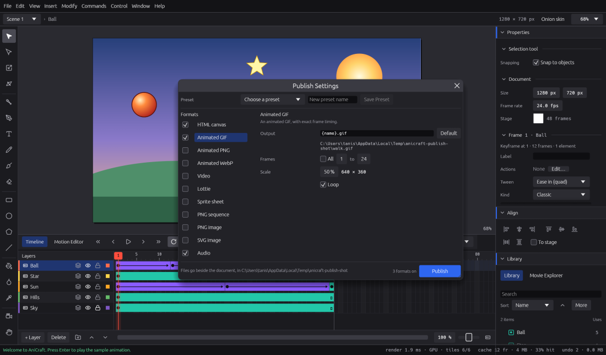

# Exporting and Publish

Get your animation out of AniCraft: as pictures, animated images, video, a web page, Lottie, a
sprite sheet or a soundtrack. Export one format at a time from **File › Export**, or set up
several once in **Publish Settings** and write them all with one key.

On a Mac, read **⌘** wherever this chapter says **Ctrl** (so **Ctrl+Shift+F12** is
**⇧⌘F12**), and **⌥** for **Alt**.

## Every format at a glance

| Format | File › Export item | Good for |
|---|---|---|
| PNG image | **Export Frame as PNG…** | A still of the current frame |
| SVG image | **Export Frame as SVG…** | A still of the current frame as a vector drawing |
| PNG sequence | **Export PNG Sequence…** | One PNG per frame, for compositing and editing tools |
| Animated GIF | **Export Animated GIF…** | Short loops anywhere; 256 colours |
| Animated PNG | **Export Animated PNG…** | Full colour and real transparency, for the web and chat apps |
| Animated WebP | **Export Animated WebP…** | Like animated PNG, lossless and usually smaller |
| Video | **Export Video…** | WebM or MP4, made by ffmpeg installed on your computer |
| Sprite sheet | **Export Sprite Sheet…** | Frames in a grid on one PNG plus a JSON frame map, for game engines |
| Lottie | **Export Lottie Animation…** | A JSON animation for websites and apps |
| HTML canvas | **Export HTML Canvas…** | One web page that plays the movie, buttons and scripts included |
| Audio | **Export Audio…** | The soundtrack as a WAV file |

The picture exports (PNG, sequences, GIF, animated PNG and WebP, video and sprite sheets) draw
exactly what the stage shows: tweens, masks, filters, blend modes, colour effects, text and the
camera included. SVG, Lottie and HTML canvas come very close, and say what they can't write.
Guide layers never export, and layers shown as outlines on the stage export as normal artwork.

## Exporting one format

1. Choose the item from **File › Export**.
2. Pick where to save it. For **Export PNG Sequence…** you pick a folder.
3. AniCraft exports and the status bar says where the file went, with its size.

File › Export uses the usual settings: the whole movie, every scene in order, at 100 %, and the
current frame for PNG and SVG stills. To choose frames, scale, looping or a background, use
**Publish Settings** (below): you can turn on just the one format you need.

If the file is already there, AniCraft asks before replacing it. A sprite sheet asks if either
the PNG or its frame map is there, and a PNG sequence asks if the folder already holds exported
frames.

## Notes on each format

### Stills and sequences

* **PNG image** and **PNG sequence** have real transparency where the stage has nothing, and
  can be scaled up to 800 %. The sequence writes `frame_00001.png` and on into its folder.
* **SVG image** writes one frame as a standalone vector drawing that matches the stage: shapes,
  strokes, gradients, masks (as clip paths), filters (as SVG filters) and blend modes. Bitmaps
  are embedded.

### Animated images

* **Animated GIF** has exact frame timing and loops by default. Like every GIF, it has only 256
  colours and hard edges on transparency.
* **Animated PNG** and **Animated WebP** keep full colour and soft transparency. They are
  transparent by default; turn on **Stage colour as background** if you want the stage colour
  behind. Choose **Loop forever**, or a number of plays. Frames that repeat are stored once and
  shown longer, so holds and small motions cost little. WebP is lossless.

### Video

AniCraft makes video with **ffmpeg**, a free program you install yourself from ffmpeg.org.
AniCraft doesn't bundle a video encoder.

* End the file name in `.webm` for **WebM** (VP9, royalty-free; the default) or `.mp4` for
  **MP4** (H.264, if your ffmpeg has that encoder).
* The soundtrack goes in too: Opus in WebM, AAC in MP4. Turn off **Include sound** in Publish
  Settings for a silent video.
* AniCraft finds ffmpeg on your system path. To use another copy, set the `ANICRAFT_FFMPEG`
  environment variable to its location. If ffmpeg can't be found, AniCraft says how to get it.
* Odd sizes are padded to even ones, which most video formats need.
* Button sounds stay out of the soundtrack.

### Sprite sheet

One PNG with the frames in a grid, and a `.json` frame map beside it in the common "JSON hash"
layout, with each frame's rectangle, size and duration. In Publish Settings you can set the
**Columns** (or **Auto**), **Padding** and **Scale**. It is transparent unless you turn on the
stage colour.

### Lottie

A Lottie JSON animation for websites and apps. Shapes, strokes, solid and gradient fills,
colour effects, opacity and masks come across, and every frame shows what AniCraft shows.

Tweens become Lottie keyframes with Lottie's own eases, so the file stays small and the motion
is smooth on any screen: No Ease, Classic Ease, Quad, Cubic, Back and Bounce, Bézier handles
and your custom curves come across exactly (a custom curve of several points becomes a key per
piece). Objects that move, turn or scale keep their shape and move as a whole. Where Lottie
has no matching ease (Elastic, Sine, Quart, Quint and Circ, motion along a curved guide, a
tween inside a tweening symbol), that motion is written frame by frame instead: still exact at
every frame, and the status bar says so.

Some things can't be written exactly; the status bar names them after the export:

* bitmaps and bitmap fills, and sound;
* masks inside masks (the innermost is kept);
* symbols fading as one (each shape fades on its own);
* stretched round gradients (drawn as circles), gradient focal points (drawn centred),
  reflected or repeated gradients (drawn extended) and linear-RGB gradients.

### HTML canvas

One self-contained web page that plays in any modern browser. Open it from your disk, put it on
a server or send it as one file.

* It is interactive: movie clips play on their own timelines, buttons show Up, Over and Down and
  answer in their Hit area, and actions and frame scripts run as in Test Movie, keyboard
  included. See [Interactivity](interactivity.md).
* Sounds play, with their effects and volumes, after the viewer's first click (browsers don't
  let pages play sound sooner). Button sounds play too.
* Input text fields are real text boxes, so typing, the clipboard and on-screen keyboards work.
  Text that a script changes is drawn with the browser's fonts.
* The movie fits the browser window and stays sharp on high-density screens. In Publish
  Settings you can turn off **Scale to the browser window**, turn off **Include sounds**, and set
  the **Page title**.
* Filters (Drop Shadow, Blur, Glow, Bevel, Gradient Glow, Gradient Bevel and Adjust Color) and
  every blend mode look as they do in AniCraft. A filtered symbol that doesn't change is filtered
  once; large filtered symbols that change every frame can slow the page down, as in any
  browser movie, so keep animated filters small.
* Plug-in frame scripts are left out of the page, and 9-slice symbols are scaled as a whole. The
  status bar lists what was left out.

### Audio

The movie's soundtrack as a WAV file: every sound as it plays in the movie, with sync, loops,
effects and layer volumes. Choose a sample rate (22,050 to 96,000 Hz) and a bit depth (16-bit,
24-bit or 32-bit float) in Publish Settings. Muted layers and button sounds stay out. If no sound
plays in the frames you export, the file is silent and the status bar says so.

## Publish Settings

**File › Publish Settings…** (**Ctrl+Shift+F12**) opens a window that stays open while you
work. Your choices are saved in the document, and every change can be undone.

1. On the left, tick each format you want to publish. Click a format's name to see its options.
2. On the right, set its **Output** name and options:

| Format | Options |
|---|---|
| HTML canvas | Page title, Include sounds, Scale to the browser window |
| Animated GIF | Frames, Scale, Loop |
| Animated PNG, Animated WebP | Frames, Scale, Playback (Loop forever or a number of plays), Stage colour as background |
| Video | Frames, Scale, Include sound |
| Lottie | Frames, Stage colour as background |
| Sprite sheet | Frames, Scale, Columns, Padding, Stage colour as background |
| PNG sequence | Frames, Scale |
| PNG image | Frame (or **Playhead**), Scale |
| SVG image | Frame (or **Playhead**) |
| Audio | Frames, Sample rate, Bit depth |

**Frames** is **All** (every frame of every scene, in order) or a range you set. Frame numbers
count through the whole movie, scene after scene.

### Output names

Output names are relative to the folder your document is saved in, and `{name}` stands for the
document's name. The defaults are `{name}.html`, `{name}.gif`, `{name}_animated.png`,
`{name}.webp`, `{name}.webm`, `{name}.json`, `{name}_sheet.png`, `{name}_frames` (a folder),
`{name}.png`, `{name}.svg` and `{name}.wav`. **Default** puts a format's usual name back.

* You can put outputs in folders below the document's, for example `web/{name}.html`.
* A name can't point outside the document's folder, and two formats can't write the same file.
* A name without an extension gets the format's. `{name}` is the only placeholder.
* Each name is checked as you type, and the full path shows below it.

### Presets

Save settings you use often as a preset, and apply them to any document:

* Type a name next to **Preset** and press **Save Preset**. Saving under an existing name
  updates that preset.
* Choose a preset from the menu to apply it. **Default** turns the HTML page on and every other
  format off. Applying a preset is one undo step.
* **Delete Preset** asks once more, because deleting a preset can't be undone.

Presets live in your preferences, not in the document.

## Publish

Choose **File › Publish** (**Shift+F12**), or press **Publish** at the bottom of Publish
Settings.

1. If the document has never been saved, AniCraft asks you to save it first, since the files go
   beside it.
2. If any output is already there, AniCraft asks once before replacing it. Files that this
   session published itself are replaced without asking again.
3. The formats publish in the background, so you can keep working. A window shows each format's
   progress, with **Cancel**.
4. When it finishes, the **Publish report** lists, for each format, what it wrote, what it
   skipped and why (video in a browser, audio with no sounds), what it left out, or why it
   failed.

One failing format doesn't stop the others.

## In the web version

Exports and Publish download their files. Publish sends several files as one ZIP named after
the document. Video export isn't available in a browser, because it needs ffmpeg; export a GIF,
animated PNG or WebP, a PNG sequence or an HTML page instead. A PNG sequence downloads each
frame on its own, and your browser may ask once to allow several downloads.

## From the command line

Every export and Publish also run without opening the window, for batch work and build
scripts. See [Working headless](working-headless.md).

## Not yet

* Lossy WebP.
* Reading Animate's own publish settings from an Animate file.
* Placeholders other than `{name}`, and outputs outside the document's folder.
