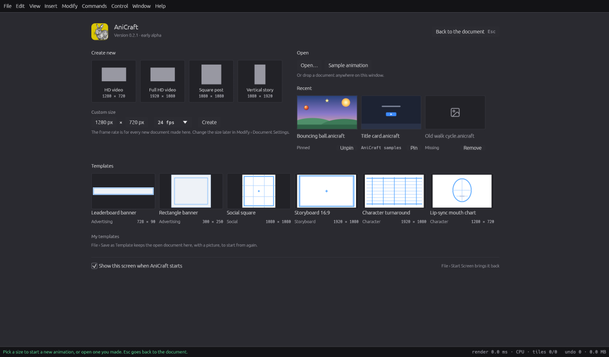
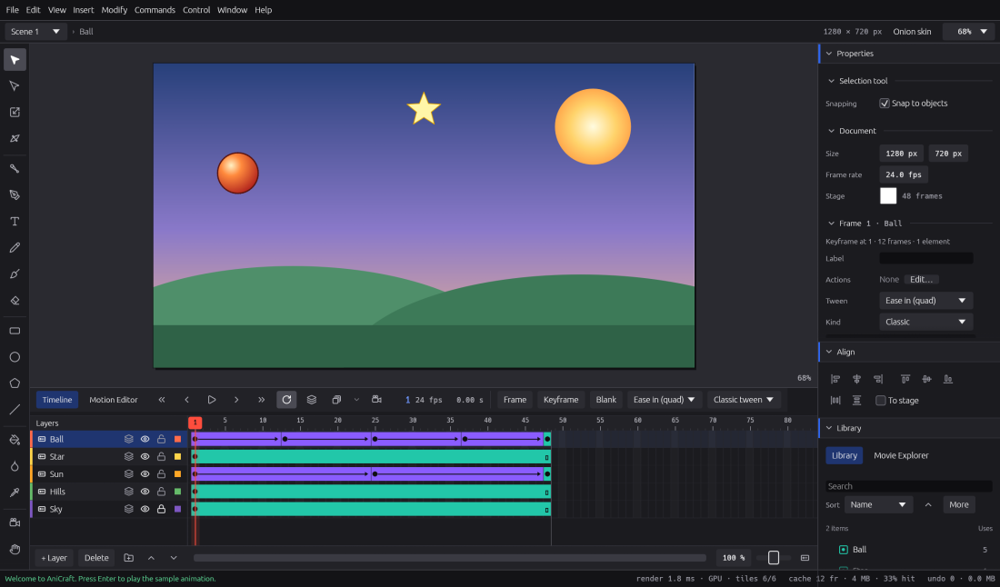

# Getting started

This chapter takes you from installing AniCraft to a finished, exported animation in about
ten minutes. You'll draw a shape, make it move, save your work and export a GIF or a video.

AniCraft is in early alpha. Most of what an animator needs every day is in place, and this
guide says plainly where something isn't there yet.

## Install AniCraft

Download AniCraft from the
[releases page on GitHub](https://github.com/storytold/AniCraft/releases). Each release
lists every build, with a `SHA256SUMS.txt` file so you can check what you downloaded.

| System | What to download | How to install |
|---|---|---|
| Windows (x64, ARM64 or 32-bit) | the `.msi` installer | Double-click it. By default it installs for your account only and doesn't need an administrator. You can choose to install it for everyone on the computer instead. A portable `.zip` is there too if you'd rather not install. |
| macOS (Apple silicon and Intel) | the `.dmg` | Open it and drag AniCraft to Applications. The app is signed and notarized. |
| Linux (x86_64 or ARM64) | `.AppImage`, `.flatpak`, `.deb`, `.rpm` or `.tar.gz` | The AppImage runs anywhere. Install the Flatpak with `flatpak install --user` and the file name. Use the `.deb` on Debian and Ubuntu, and the `.rpm` on Fedora and openSUSE. |
| FreeBSD | the `.tar.gz` | Unpack it anywhere. |

Every installer sets AniCraft up to open `.anicraft` documents. Animate's `.fla` and `.xfl`
files show AniCraft under "Open with", but your default app for them doesn't change. The
command-line tool, `anicraft-cli`, is installed alongside the app (see
[Working headless](working-headless.md)).

There is also a web version that runs in a modern browser. It can't play sound, export video
or install plug-ins yet, and menu items that can't work there are dimmed and say why.

To get newer versions later, choose **Help › Check for Updates…**.

## A note on keys

This guide writes shortcuts the Windows and Linux way. On macOS, AniCraft uses ⌘ (Command)
wherever the guide says Ctrl, and ⌥ (Option) wherever it says Alt. So **Ctrl+S** is **⌘S**
on a Mac, and **Ctrl+Shift+S** is **⇧⌘S**. The menus always show the keys for your computer, and you can change any shortcut
(see [Preferences, shortcuts and accessibility](preferences-shortcuts-accessibility.md)).

## The start screen

When you open AniCraft without a document, the start screen appears.

From here you can:

* **Create new**: pick a size. HD video is 1280 × 720, Full HD video is 1920 × 1080, Square
  post is 1080 × 1080 and Vertical story is 1080 × 1920. Under **Custom size**, type a width
  and height, choose a frame rate and press **Create**.
* **Templates**: start from a ready-made document: Leaderboard banner (728 × 90), Rectangle
  banner (300 × 250), Social square (1080 × 1080 at 30 fps), Storyboard 16:9 (six labelled
  panels), Character turnaround and a Lip-sync mouth chart. Templates come with named layers,
  and with guides on a locked guide layer that show while you draw but never export.
  Templates you save yourself appear under **My templates**.
* **Open…**: open an AniCraft document, or an Animate `.fla` or `.xfl` file.
* **Sample animation**: open a short animation (a bouncing ball, a spinning star and a sun
  over hills, 48 frames at 24 fps) to look at and take apart.
* **Recent**: your last documents, each with a picture of its first frame. You can pin
  favourites to the top, and remove files from the list.

You can also drop a document anywhere on the window to open it.

Press **Esc** to close the start screen and go back to the document behind it. To get the
screen back later, choose **File › Start Screen**. If you'd rather not see it at every start,
clear **Show this screen when AniCraft starts** at the bottom.

The same choices are in the File menu: **File › New** (**Ctrl+N**, **⌘N** on macOS),
**File › New from Template…**, **File › New from Sample**, **File › Open…** (**Ctrl+O**)
and **File › Open Recent**.

## The window at a glance

* The **Tools** panel is the column on the left.
* The **stage** in the middle is your canvas. What's inside the stage rectangle is what your
  movie shows.
* The **Timeline** below holds the layers and frames.
* **Properties**, **Align**, the **Library** and **History** are on the right.
* The **status bar** at the bottom tells you what the current tool does and what just
  happened.

The [Workspace](workspace.md) chapter explains each part.

## Draw your first shape

1. Make a new document: on the start screen, click **HD video**.
2. Pick the **Rectangle** tool in the Tools panel, or press **R**.
3. In **Properties**, under **Rectangle tool**, click the **Fill** swatch and choose a colour.
   The **Stroke** row sets the outline's colour and width. Its checkbox turns the outline off.
4. Drag on the stage. Hold **Shift** to draw a square.
5. Press **V** for the **Selection** tool, then click the shape to select it. Drag it to
   move it.

Try the **Oval** tool (**O**) as well, and the **Brush** (**B**) for painting by hand. The
[Drawing](drawing.md) chapter covers every tool.

## Make it move: your first tween

A tween fills in the frames between two poses for you. Here is the classic way, which works
as it does in Animate.

1. Select your shape with the Selection tool (**V**).
2. Choose **Modify › Convert to Symbol…** (**F8**). Give it a name, choose **Graphic** as
   the type, and press **OK**. The shape is now an instance of a symbol in the Library.
3. In the timeline, click frame 24 of the layer and press **F6** (**Insert › Timeline ›
   Keyframe**). The layer now runs from frame 1 to frame 24, with a keyframe at each end.
4. With the playhead on frame 24, drag the instance to a new place on the stage. You can
   also scale or rotate it with the **Free Transform** tool (**Q**).
5. Click any frame between 1 and 23, then choose **Insert › Create Classic Tween**. You can
   also use the **Create tween** menu in the timeline's header.
6. Press **Enter** to play it, and **Enter** again to stop.

To ease the motion in or out, click a frame inside the tween and pick an easing preset from
the timeline header. Motion tweens, shape tweens and easing curves are in
[Tweens](tweens.md).

## Save your work

Choose **File › Save** (**Ctrl+S**). The first time, AniCraft asks for a name and a place.
Documents are saved as `.anicraft` files. Each one is a single file that holds everything,
including the images and sounds you imported. To save a copy under a new name, choose
**File › Save As…** (**Ctrl+Shift+S**).

AniCraft works on one document at a time. If you open or create another document while yours
has unsaved changes, it asks you first, and it does the same when you quit.

To start new documents from this one later, choose **File › Save as Template…**. Give the
template a name and a category. It then appears under **My templates** on the start screen.

## Autosave and crash recovery

While you work, AniCraft quietly keeps a recovery copy of your unsaved changes. By default it
does this every minute, or after 25 changes, whichever comes first. The status bar shows when
it last did ("autosaved just now"). The copy never replaces your own file. It is kept in
AniCraft's settings folder and removed when you save or quit normally. Drawing never waits
for it.

If AniCraft closes unexpectedly, the next start shows a **Recover unsaved work** window:

* **Restore** opens the work as an unsaved document. Save then puts it back where it was.
  If the file was saved after the copy was made, Save asks for a new name instead, so
  nothing is overwritten.
* **Discard…** deletes the copy. You have to confirm it, because this can't be undone.
* **Later** keeps the copy. **File › Recover Autosaved Documents…** brings it back.

To change how often autosave runs, or to turn it off, go to **Preferences › Files ›
Autosave**.

## Undo anything

Every change you make can be undone:

* **Edit › Undo** (**Ctrl+Z**) takes back the last step, and the menu item names it.
* **Edit › Redo** (**Ctrl+Y**) brings it back.
* The **History** panel, at the bottom of the right-hand dock, lists every step. Click one to
  go straight back to that point.

A whole drag counts as one step, however long it takes. Because undo is always there,
AniCraft doesn't stop you with "are you sure?" questions for everyday edits. When something
big disappears, the status bar says how to undo it. AniCraft only asks first when the loss
would be hard to recover, such as deleting a scene full of artwork or discarding autosaved
work.

## Export a GIF or a video

To export an **animated GIF**:

1. Choose **File › Export › Export Animated GIF…**.
2. Pick a name and a folder. AniCraft writes the GIF straight away, with the whole movie,
   looping.

To export a **video**:

1. Install ffmpeg, the free video tool, if you haven't already. AniCraft uses your own copy
   of ffmpeg and doesn't include a video encoder. If it can't find ffmpeg, it tells you how
   to get it.
2. Choose **File › Export › Export Video…**.
3. Pick a name ending in `.webm` (the default, royalty-free) or `.mp4`. The video includes
   your movie's sound.

For full-colour animation with real transparency, which GIF can't do, use **Export Animated
PNG…** or **Export Animated WebP…** in the same menu. To set up several formats at once and
write them all with one key, use **File › Publish Settings…** and **File › Publish**
(**Shift+F12**). See [Exporting and publishing](exporting-and-publish.md).

To watch your movie play with its buttons and scripts working, choose **Control › Test Movie**
(**Ctrl+Enter**).

## Where to go next

* [Workspace](workspace.md): panels, the command palette, zooming and panning, scenes.
* [Drawing](drawing.md): every tool, and how shapes merge.
* [Symbols and the Library](symbols-and-library.md): reusable artwork, movie clips and
  buttons.
* [Timeline](timeline.md) and [Tweens](tweens.md): layers, keyframes and animation.
* [Coming from Animate](coming-from-animate.md): what's the same, what's different and
  what isn't there yet.
* [Opening Animate files](opening-animate-files.md): bring your `.fla` and `.xfl` work
  across.
* [Troubleshooting and FAQ](troubleshooting-and-faq.md): when something doesn't go as
  expected.
