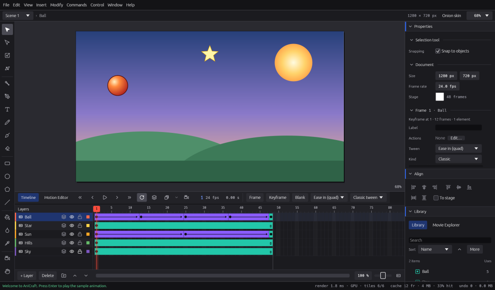

# AniCraft User Guide

Welcome to AniCraft, a free and open-source 2D animation studio for Windows, macOS, Linux and the
web browser. This guide is written for artists: it shows you where things are and how to get
work done, one task at a time. You don't need to read it in order.

**Coming from Adobe Animate?** Start with [Coming from Animate](coming-from-animate.md): it maps
the panels, tools and shortcuts you know to AniCraft's, and lists what works differently.

## Start here

1. [Getting started](getting-started.md): install AniCraft, make your first animation and save it.
2. [The workspace](workspace.md): the panels, the stage, the command palette and finding your way around.

## Making animation

3. [Drawing](drawing.md): the drawing tools, raw drawing and drawing objects, colour, strokes and transforms.
4. [Symbols and the Library](symbols-and-library.md): graphics, movie clips and buttons you reuse.
5. [The timeline](timeline.md): layers, frames and keyframes, onion skin and Edit Multiple Frames.
6. [Tweens](tweens.md): classic, shape (with shape hints) and motion tweens, the Motion Editor and motion paths.
7. [Masks, guides, camera and bones](masks-guides-camera-bones.md): mask and guide layers, the camera and inverse kinematics.
8. [Text](text.md): static, dynamic and input text.
9. [Images and sound](images-and-sound.md): bitmaps, SVG files and sound on the timeline.
10. [Interactivity](interactivity.md): actions, buttons, frame scripts and Test Movie.

## Sharing your work

11. [Exporting and Publish](exporting-and-publish.md): pictures, GIFs, animated PNG and WebP, video, HTML and Publish Settings.
12. [Opening Animate files](opening-animate-files.md): what comes across from `.fla` and XFL, and what AniCraft tells you about the rest.

## Making AniCraft yours

13. [Preferences, shortcuts, accessibility and languages](preferences-shortcuts-accessibility.md).
14. [Plug-ins](plugins.md): add commands safely.
15. [Working headless](working-headless.md): the command line and AI assistants, for pipelines.

## Help

16. [Troubleshooting and FAQ](troubleshooting-and-faq.md).
17. [Coming from Animate](coming-from-animate.md).

## Reference

* [Command reference](reference/commands.md): every command, with its menu, shortcut and parameters.
* [Shortcut reference](reference/shortcuts.md): every default key, for Windows and Linux and for macOS.

Both reference pages are generated from AniCraft itself, so they always match the version you
have. On macOS, **Ctrl** in this guide means **⌘** (Command) and **Alt** means **⌥** (Option).

## About this guide

The guide comes with AniCraft: **Help › User Guide** opens it in your web browser, and it works
without an internet connection. You can also read it on
[GitHub](https://github.com/storytold/AniCraft). Found a mistake or something missing? Please
[open an issue](https://github.com/storytold/AniCraft/issues).

AniCraft is not affiliated with or endorsed by Adobe. Adobe and Animate are trademarks of Adobe;
they are named here only to describe what AniCraft can work with.
