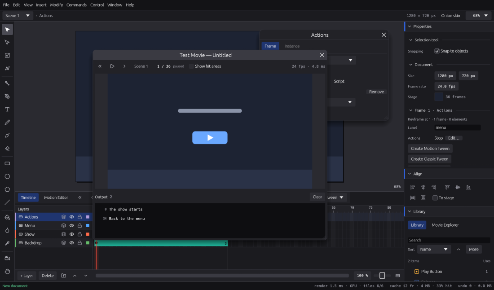

# Interactivity

Make a movie that stops, waits for a click and carries on: menus, quizzes, e-learning screens
and small games. You can do it without writing code, with the Actions panel, or with frame
scripts in a subset of ActionScript 3.0, and try it at once in Test Movie.

On a Mac, read **⌘** wherever this chapter says **Ctrl** (so **Ctrl+Enter** is **⌘↩**), and
**⌥** for **Alt**.

## How it fits together

* **Frame actions** run when the playhead enters a keyframe: stop here, go to a label, and so on.
* **Events** on a button or movie clip instance run when the viewer clicks it or points at it.
* **Instance names** let actions and scripts talk to a particular button, movie clip or text
  field.
* **Test Movie** plays it all live, in its own window.

Interactivity runs in Test Movie and in the HTML canvas export. Every other export (video, GIF,
PNG and so on) shows the timeline as you authored it, playing straight through.

## Naming instances

Actions and scripts find things by name, so name what you want to control.

1. Select a movie clip or button instance on the stage.
2. In **Properties › Instance**, type a name such as `play_btn` or `hero_mc`.

Names use letters, digits and `_`, and don't start with a digit. A button's own events work
without a name. Dynamic and input text fields take an instance name too (see
[Text](text.md)). To reach something inside a clip, join the names with dots: `hero.arm`.

## The Actions panel

Open it with **Window › Actions** (**F9**). It floats beside your work and edits live: every
change is one undo step. Keyframes with actions or a script show a small "a" on the timeline.

It has two tabs: **Frame**, for what a keyframe does, and the instance tab, for what the
selected button or movie clip does on events.

### Actions on a keyframe

1. Click the frame on the timeline. It needs a keyframe: press **F7** for a blank keyframe or
   **F6** for a keyframe if there isn't one. Many people keep actions on a layer of their own
   called "Actions".
2. Open the **Frame** tab. The **Timeline** menu says whose frames you are editing: the scene's
   main timeline, or any movie clip in the Library.
3. Leave **Type** on **Actions** and press **Add action**.
4. Pick the action and fill in its settings. Targets, frames, labels and scenes come from menus
   built from your document, so you rarely type anything.

| Action | What it does |
|---|---|
| **Stop** | Holds the playhead on this frame. |
| **Play** | Carries on playing. |
| **Go to and play** / **Go to and stop** | Jumps to a frame number or a label, in this scene or another. |
| **Next frame** / **Previous frame** | Steps one frame. |
| **Next scene** / **Previous scene** | Jumps to the start of the next or previous scene. |
| **Trace** | Writes a message to Test Movie's Output, handy for checking what ran. |
| **Set property** | Sets x, y, alpha, shown (visible), rotation or scale on an instance. |

Each action has a **Target**: this timeline, or a named instance. Use **Move up** and **Move
down** to change the order, and **Remove** to drop one.

Tip: go to **labels** rather than frame numbers. Name a keyframe in **Properties › Label**;
labels keep working when you add or move frames.

Graphic and button timelines, guide layers and layer folders don't run frame actions, and the
panel says so.

### Events on a button or movie clip

1. Select one button or movie clip instance on the stage. (A graphic can't have events; change
   its symbol's **Type** in Properties first.)
2. Open the instance tab in the Actions panel, or press **Actions…** in Properties.
3. Press **Add event** and choose one:

| Event | When it fires |
|---|---|
| **Click** | Pressed and released on it |
| **Press** | The pointer goes down on it |
| **Release** | The pointer comes up over it |
| **Pointer over** | The pointer moves onto it |
| **Pointer out** | The pointer leaves it |

A new event starts with **Play**, the action people want most. Add, reorder and remove actions
as on a keyframe. An event's actions run on the timeline the instance sits on, so "this" is the
main timeline.

The classic pattern is a **Stop** on a frame, and a button whose **Click** goes to the next part.

## Buttons

A button is a symbol with four special frames.

1. Draw the button, select it and choose **Modify › Convert to Symbol…** (**F8**). Set **Type**
   to **Button**.
2. Double-click the instance to edit it in place. The timeline names its frames **Up**, **Over**,
   **Down** and **Hit**.
3. Add keyframes (**F6**) on Over and Down and change the artwork for each state.
4. On **Hit**, draw the area that should answer the pointer. It is never seen in the movie;
   while you edit the button, the stage draws it translucent over the other states.

If the button has no Hit frame, it answers where its Up artwork is. Put a sound on the Over or
Down frame to hear it as the pointer goes over or presses (see
[Images and sound](images-and-sound.md#sounds-inside-symbols-and-buttons)).

## Test Movie

Choose **Control › Test Movie** (**Ctrl+Enter**, **⌘↩** on macOS). The movie plays from the
first frame at its frame rate, with buttons, actions, scripts and sound, in a window of its own
sized to the stage.



* At the top: **Restart** (or **Ctrl+Enter** again), **Pause** and **Play**, and **Step one
  frame** while paused. Next to them, the scene, the frame number and whether the movie is
  playing or stopped.
* **Show hit areas** draws where every button answers the pointer.
* **Output**, below the movie, shows Trace messages and anything that couldn't run. Its first
  lines say which scripts run and which don't, and why.
* The keyboard goes to the movie when the window opens or when you click the movie, and the bar
  says so when the movie listens for keys. Shortcuts with **Ctrl** or **Alt** still reach the
  editor.
* **Esc** or **Ctrl+W** closes the window.

Test Movie plays a copy of your document made when it opened. Your stage, playhead and undo
history stay as they were, and **Restart** picks up your latest changes. The window opens where
you left it last time (on Wayland, the desktop decides where it goes).

To keep Test Movie inside the editor instead, turn off **Preferences › Test Movie › Play Test
Movie in a window of its own**. In the web version, and wherever the system can't open another
window, it floats inside the editor and says why.

## Frame scripts in ActionScript 3.0

Animate documents often carry ActionScript on their frames, and you can write your own. In the
Actions panel's **Frame** tab, set **Type** to **Script**. The script view has line numbers, a
**Language** menu and edits live; a burst of typing undoes in one step.

```actionscript
stop();
var score:int = 0;

play_btn.addEventListener(MouseEvent.CLICK, onPlay);

function onPlay(e:MouseEvent):void {
    score += 1;
    score_txt.text = "Score: " + score;
    gotoAndPlay("intro");
}
```

Above the code, the panel says either **Runs in Test Movie and the HTML canvas export**, or
**Doesn't run** with each problem, its line and its column. Click a problem to put the cursor
there; lines with problems are marked by their numbers.

### What runs

* **Timeline control**: `stop()`, `play()`, `gotoAndPlay` and `gotoAndStop` by frame or label
  (and scene), `nextFrame()`, `prevFrame()`, `nextScene()`, `prevScene()`, on this timeline or on
  named instances (`hero_mc.gotoAndStop("run")`, `MovieClip(parent).play()`).
* **Variables** typed `Number`, `int`, `uint`, `Boolean` or `String`, or untyped. A variable
  belongs to its timeline, so every frame script of that timeline shares it, as in Animate.
* **Expressions**: arithmetic, comparisons, logic, joining text, `Math.min`, `max`, `abs`,
  `floor`, `ceil`, `round` and `random`, `Math.PI`, and casts such as `int(…)` and `String(…)`.
* **Decisions and loops**: `if`/`else`, `for`, `while`, `do … while`, `break` and `continue`.
* **Functions** with parameters and results, callable from any frame of the same timeline.
* **Properties**: set and read `x`, `y`, `alpha`, `visible`, `rotation`, `scaleX` and `scaleY`;
  read `name`, `mouseX`, `mouseY`, `currentFrame`, `totalFrames` and `currentLabel`.
* **Listeners**: mouse events on buttons and movie clips (`CLICK`, `MOUSE_DOWN`, `MOUSE_UP`,
  `ROLL_OVER`, `ROLL_OUT`), `Event.ENTER_FRAME`, and `KeyboardEvent.KEY_DOWN` and `KEY_UP` on
  the stage with `e.keyCode` and the `Keyboard` constants; `removeEventListener`;
  `e.target` and `e.currentTarget`.
* **Text fields**: set and read `.text`, use `appendText(…)`, and read `.length` on dynamic and
  input text fields.
* `trace(…)`, which writes to Output.

Keys and frames, for a small game:

```actionscript
stage.addEventListener(KeyboardEvent.KEY_DOWN, onKey);
addEventListener(Event.ENTER_FRAME, onTick);

function onKey(e:KeyboardEvent):void {
    if (e.keyCode == Keyboard.RIGHT) {
        hero_mc.x += 10;
    }
}

function onTick(e:Event):void {
    wheel_mc.rotation += 5;
}
```

`Math.random()` gives new numbers each time you start Test Movie.

### What doesn't run yet

* `switch`, `for in` and `for each`, arrays, objects and `new`, string methods, bitwise
  operators, `try`/`throw`, closures and functions inside functions.
* Event bubbling, mouse listeners on the stage, and event fields such as `stageX` and
  `charCode`.
* `getChildByName`, stage properties, sound and timers from scripts.
* `Event.CHANGE` and other text field events, `htmlText` and text formatting from scripts.
* ActionScript 1.0 and 2.0, and scripts attached to instances in older documents.
* `navigateToURL` and other calls that reach outside the movie are ignored and noted in Output.

### How scripts fail safely

A script runs whole or not at all: if any part of it is outside the subset, none of it runs,
and the Actions panel and Test Movie's Output say why. Scripts that don't run are still kept
exactly as written, so nothing is lost and they go back out with your document.

While the movie plays, an endless loop or an error (such as an instance that isn't there) stops
only that script, with a line in Output; what it did before stays done and the movie plays on.

## In the HTML canvas export

**File › Export › Export HTML Canvas…** writes a web page that runs the same actions, events and
scripts as Test Movie, keyboard included, and plays button sounds. Input text fields become real
text boxes in the browser. See [Exporting and Publish](exporting-and-publish.md).

## Frame-script plug-ins

A keyframe's **Type** can also be **Plug-in**: a sandboxed plug-in runs each time the playhead
enters the keyframe, reads where the movie is and sends actions back. It can't change your
document. See [Plug-ins](plugins.md).

## Not yet

* Full-screen Test Movie, zooming in its window, and remembering its size.
* Masks taken into account when testing what the pointer is over.
