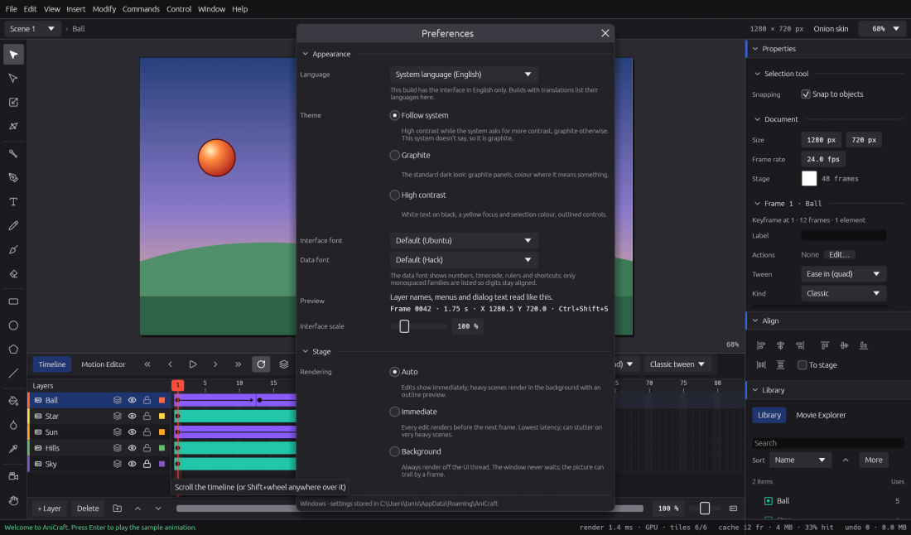

# Preferences, shortcuts, accessibility and languages

This chapter shows how to make AniCraft yours: its preferences, your own keyboard shortcuts, the
command palette, working with the keyboard or a screen reader, and the interface language.

On macOS, press ⌘ where this guide says Ctrl, and ⌥ where it says Alt.

## Preferences

Open Preferences with **Edit › Preferences…** (**Ctrl+U**) on Windows and Linux. On macOS the
window is called Settings and lives in the application menu: **AniCraft › Settings…** (**⌘,**,
and **⌘U** works too).

There is no OK button. Every change shows at once, and **Esc** closes the window. The line at the
bottom says which system you are on and where your settings are kept.

### Appearance

* **Language**: the language of menus, panels and dialogs. See
  [Interface languages](#interface-languages) below.
* **Theme**: **Dark (Graphite)** (the default, which still switches to High contrast while
  your computer asks for more contrast), **Follow system**, **Light** or **High contrast**.
  Follow system is light or dark as your computer's apps are, and switches to High
  contrast while your computer asks for more contrast; it changes within a few seconds of your
  system, without a restart. The note under it says what your system is set to right now. A theme
  you pick by hand stays whatever the system says, and every theme applies as soon as you click it.
  * **Dark (Graphite)**: graphite panels, with colour where it means something.
  * **Light**: light grey panels and near-black text, for bright rooms and for eyes that find dark
    interfaces hard to read. Timeline blocks keep their colours (mint artwork, violet classic
    tweens, amber shape tweens, sky-blue motion tweens) in deeper tones that stand out on light
    grey.
  * **High contrast**: see [High contrast](#high-contrast) below.
* **Interface font** and **Data font**: the bundled typefaces, or any font installed on your
  computer. The data font shows numbers, timecode, rulers and shortcuts, so only monospaced
  families are listed for it. The **Preview** row shows both.
* **Interface scale**: from 75 % to 200 %, on top of your system's display scaling. The new size
  applies when you let go of the slider.

### Stage

* **Rendering** decides when the stage redraws after an edit:
  * **Auto** (the default): edits show immediately. Heavy scenes render in the background, with
    an outline preview of what you drag.
  * **Immediate**: every edit is drawn before the next frame. Lowest latency, but very heavy
    scenes can stutter.
  * **Background**: always drawn off to the side. The window never waits, but the picture can
    trail by a frame.
* **Renderer**: **Graphics card (GPU)**, the default, or **CPU (reference)**. The picture is the
  same either way. The note below says which graphics card is drawing, or why the CPU took over.
  Exports always use the CPU renderer.

Both settings are also in **View › Stage Rendering**, so you can switch without opening
Preferences.

* **Window graphics**: how the whole window is drawn. **Automatic** (the default) tries the best
  way for your computer first and the next one if it doesn't work. If the window flickers or
  goes black, choose another way: **DirectX 12**, **Vulkan** or **OpenGL** on Windows, **Metal**
  or **OpenGL** on a Mac, **Vulkan** or **OpenGL** on Linux. A change takes effect the next time
  AniCraft starts. The note below names the start-up log to attach to a bug report.

### Timeline, Test Movie, Files and Safety

* **Timeline › Extra start gap** adds room before frame 1, on top of the room the playhead needs.
* **Test Movie › Play Test Movie in a window of its own**: on by default. Turn it off to have the
  movie float inside the editor instead.
* **Files › File dialogs**: use your system's open and save dialogs. Turn this off on a Linux
  desktop without a desktop portal, and AniCraft asks for a path instead.
* **Files › Autosave** keeps a recovery copy of unsaved work. Choose how often (**Every** 30
  seconds to 10 minutes, 1 minute by default) and **Or after** a number of changes (25 by
  default; 0 means by time only). Copies are written in the background, so drawing never waits.
* **Safety › Confirmations**: if you ticked "Don't ask again this session" in a confirmation,
  **Show all again** brings those questions back.

Preferences also keep your shortcuts, onion skin options, Publish presets, recent files and
whether the start screen shows. The start screen has its own checkbox: **Show this screen when
AniCraft starts**.

## Keyboard shortcuts

Every menu command, every tool and the view keys (zoom, onion skin, panel focus and so on) can
have shortcuts. The full list of defaults is in [the shortcut reference](reference/shortcuts.md).

Open the editor with **Help › Keyboard Shortcuts** (**F1**). Actions are grouped by menu, then
**Tools**, **View** and **Other**. Type in **Filter by name or key…** to find an action by its
name or by the key it uses: typing `F6` shows what F6 does.

### Change a shortcut

1. Find the action and click its key. To add a second key instead, click **+**.
2. The button says **Press keys…**. Press the new key or chord, for example **Ctrl+Alt+K**.
3. The new key works straight away. Esc cancels without changing anything.

To remove a key, right-click it and choose **Remove**. An action can have up to four keys, or
none.

Each action has a **Reset** button that puts back its default keys (the tooltip says what they
are). **Reset all…** at the top puts every shortcut back, after asking.

Changes save as you go. Only the shortcuts you changed are stored, so every action you never
touched keeps following AniCraft's defaults when they improve in a later version. Menus, tooltips
and the command palette always show the keys in effect, including yours.

### When a key is already taken

If the key you press belongs to another action, AniCraft says so, for example "F5 is already used
by Frame". You can then:

* choose **Use it for** (your action) to move the key over, so the other action loses it, or
* choose **Cancel** to keep things as they were.

### Keys that stay fixed

A few keys are handled before the shortcut map, so they always do the same thing. The editor
lists them as **fixed** and won't assign them to anything else:

| Key | Kept for |
|---|---|
| **Ctrl+K**, **Ctrl+Shift+P** | the command palette |
| **F1**, **Ctrl+Alt+Shift+K** | the shortcut editor |
| **Ctrl+U**, **Ctrl+,** | Preferences |
| **Ctrl+Q** | quitting |
| **Enter** | play and stop |
| **Esc** | cancelling |
| **Space** | panning with any tool (hold it and drag) |
| **Tab** | moving between fields |

## The command palette

The command palette finds anything by name, so you never have to remember where a command lives.

1. Press **Ctrl+K** (or **Ctrl+Shift+P**), or choose **Help › Command Palette…**.
2. Type part of a name: "keyframe", "onion", "export gif", "pen".
3. Use **Up** and **Down** to choose, **Enter** to run it and **Esc** to close.

The palette lists every menu command, every tool, view settings and your installed plug-ins, each
with its current shortcut.

## Accessibility

AniCraft aims to work with the keyboard alone, with a screen reader, at large sizes and in high
contrast.

### Moving around with the keyboard

* **Ctrl+F6** moves the keyboard focus to the next panel: Stage, Timeline, Properties, Library,
  then Tools. **Ctrl+Shift+F6** goes back. The status bar says where you landed. (F6 alone still
  inserts a keyframe, as animators expect.) You can rebind both keys under **View** in the
  shortcut editor.
* Inside a panel, **Tab** and **Shift+Tab** move between controls. **Enter** or **Space** presses
  a button, ticks a checkbox or opens a menu, and the arrow keys change a slider or number field.
* The focused control always has a visible ring around it. When the stage has focus, the ring goes
  around the whole stage.
* With a button or checkbox focused, Enter, Space and the arrows belong to it, but your other
  shortcuts keep working. In a text field, every key types. **Esc** leaves the field.
* In the **Library**, click a row and press **Enter** to place the selected items in the middle of
  the view, without dragging. **F2** renames and **Delete** deletes.

### Selecting on the stage without a pointer

1. Press **Ctrl+F6** until the stage has focus.
2. Press **Tab**. Focus goes to the first selected element (or the first element), and a ring
   shows it on the artwork.
3. Move with **Tab**, **Shift+Tab** or the arrow keys.
4. Press **Enter** or **Space** to select the focused element alone. **Shift+Enter** or
   **Shift+Space** adds it to the selection or takes it out, as Shift-click does.
5. Use any shortcut on the selection: **Delete**, **F8** for Convert to Symbol, **Ctrl+D** to
   duplicate.
6. Press **Esc** to go back to the stage itself, where the arrow keys nudge the selection again.

Elements on locked layers are listed but can't be selected.

### The timeline with the keyboard

With the timeline focused, **Left** and **Right** move the playhead one frame, and **Up** and
**Down** move to the layer above or below. Each move is announced, for example "Frame 12 · Ball ·
Frames 1–24: keyframe · motion tween". The usual keys work too: **,** and **.** for the previous
and next frame, **Home** and **End**, and **F5**, **F6** and **F7** to insert.

### The menu bar with the keyboard

On Windows and Linux:

1. Press and let go of **Alt**, or press **F10**. The File menu gets focus, and each menu title
   shows its letter underlined.
2. **Left** and **Right** move between menus. **Down**, **Enter** or **Space** opens one.
3. **Up** and **Down** move through the items. **Right** opens a submenu and **Left** comes back.
4. **Enter** runs the item. **Esc** closes the menu; press it again to leave the menu bar.

You can also open a menu directly: **Alt+F** File, **Alt+E** Edit, **Alt+V** View, **Alt+I**
Insert, **Alt+M** Modify, **Alt+C** Commands, **Alt+O** Control, **Alt+W** Window and **Alt+H**
Help. If you bind one of these to something else in the shortcut editor, your binding wins.

On macOS the menu bar has no keyboard route yet. Use **⌘K**: the command palette reaches every
menu command.

### Screen readers

AniCraft works with the screen reader built into your system: Narrator (or NVDA) on Windows,
VoiceOver on macOS and Orca on Linux.

* Every button, toggle, field, slider, menu and list row has a name. Icon buttons are named with
  their shortcut, for example "Pen tool (P)".
* Number fields say what they hold: "Position X, spin button, 120".
* The stage is announced with the tool, the frame and the selection: "Stage · Selection tool ·
  frame 12 · 1 element selected".
* While the stage has focus, its elements are read as a list: "ball · Graphic: Ball", "Text:
  Hello", "Rectangle", each with its layer, position and size, and whether it is selected. Give
  instances a name in Properties to hear them by name.
* The active layer's frames are read as a list of spans, such as "Frames 1–24: keyframe · motion
  tween · label “walk”". Activating one moves the playhead there.
* The status bar is read aloud after each action ("Deleted layer — Ctrl+Z to undo") without
  moving your focus.

These names and roles are checked by automated tests on every change. Full sessions with each
screen reader on real machines are still to be done, so the exact phrasing may differ from reader
to reader. Tell us what you find (see [Troubleshooting and FAQ](troubleshooting-and-faq.md)).

### High contrast

With **Theme › Follow system**, AniCraft switches to high contrast within a few seconds when you
turn on:

* **Windows**: a contrast theme (Settings › Accessibility › Contrast themes).
* **macOS**: Increase Contrast (System Settings › Accessibility › Display).
* **Linux**: your desktop's high contrast setting.
* **In a browser**: the browser's "more contrast" preference.

The **High contrast** theme is white text on black, with yellow for focus, selection and the
active tool, and an outline on every button and field. Text reaches at least 7:1 contrast. Your
artwork on the stage keeps its own colours. Choose **Dark (Graphite)**, **Light** or **High
contrast** by hand to keep that look whatever the system says.

### Larger interface

Set **Preferences › Appearance › Interface scale** up to 200 %. The stage refits, the tools column
scrolls, and the timeline header scrolls sideways (**Shift** and the mouse wheel). To try a look
for one session without saving it, start AniCraft from a terminal with
`anicraft --theme high-contrast --scale 200` (or `--theme light`, `--theme dark`).

### Not there yet

* The Motion Editor's graph needs a pointer. Its values and eases can be edited in the property
  list beside it.
* Adding a point in Edit Envelope takes a click; existing points can be edited from the keyboard.
* Shapes are named by their outline ("Rectangle", "Oval"); a brush stroke is just a "Shape".

## Interface languages

Choose a language in **Preferences › Appearance › Language**. It is the first setting in the
window, so you can find it even when you can't read the current language, and each language is
listed in its own name. **System language** (the default) follows your computer, or your browser
in the web version. A change shows at once.

What is translated: menus, panels, the timeline, Properties, tool options, dialogs, tooltips,
status messages and the names screen readers announce.

What stays as it is: your documents (layer, symbol and scene names), the file format, and the
command line and assistant tools described in [Working headless](working-headless.md), so scripts
behave the same everywhere. Error messages, import reports and the text of confirmations are
still in English for now.

Today AniCraft's interface is in English only. Translations come from the Craft family's shared
translation catalogues, which don't have an AniCraft catalogue yet; Preferences says so when your
build has no other languages. If you would like to translate AniCraft, open an issue on
[GitHub](https://github.com/storytold/AniCraft/issues).

To start in a language for one run, without saving it, use `anicraft --lang <code>` (for example
`--lang de`), or `--lang auto` for the system language.
