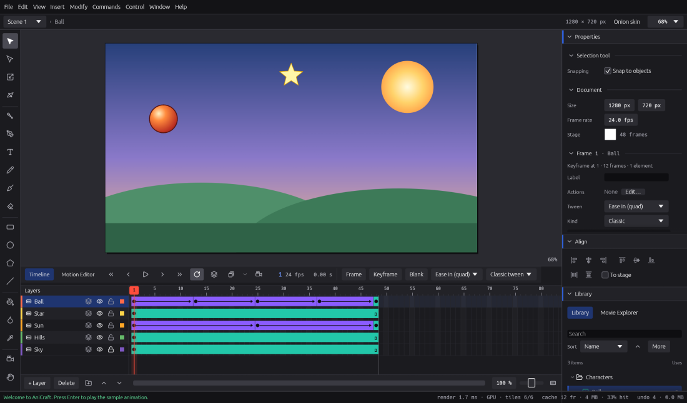

# Symbols and the Library

Symbols are reusable pieces of artwork with timelines of their own. You draw something once,
keep it in the Library and place it as many times as you like. Change the symbol and every
copy changes with it. This chapter covers the three kinds of symbol, editing them, setting up
their instances, and organising the Library.

Shortcuts are written the Windows and Linux way. On macOS, use ⌘ (Command) for Ctrl and ⌥
(Option) for Alt: **Ctrl+E** is **⌘E**.

## Symbols and instances

A **symbol** lives in the Library. Each copy of it on the stage is an **instance**. Instances
share the symbol's artwork, but each one has its own position, size, rotation, colour effect
and, for movie clips and buttons, its own name, filters and blend mode.

Symbols are also what you animate with classic and motion tweens, and what you join with the
Bone tool.

### The three kinds

| Kind | How it plays | Good for |
|---|---|---|
| **Graphic** | Its timeline keeps step with the timeline it's placed on. Frame 5 of the scene shows frame 5 of the graphic. | Animation you want to scrub and time exactly: walk cycles, lip sync, background loops. |
| **Movie clip** | Plays its own timeline on a loop from the moment it appears, whatever the parent timeline does. | Independent animation, and anything with filters, blend modes or an instance name for scripts. |
| **Button** | Shows its **Up** frame, and its **Over**, **Down** and **Hit** frames as the pointer moves over and presses it in Test Movie and HTML export. | Clickable buttons. |

You can change a symbol's kind at any time: select an instance and change **Type** in
Properties, or change **Type** in the Library's item properties.

## Making a symbol

To turn artwork into a symbol:

1. Select the artwork. It can be on several layers.
2. Choose **Modify › Convert to Symbol…** (**F8**), or click **Convert to Symbol** at the
   bottom of Properties.
3. Type a **Name**, choose a **Type** (Graphic, Movie clip or Button), and choose the Library
   **Folder** it goes into.
4. Press **OK**.

The artwork is replaced by an instance of the new symbol. If you selected artwork on several
layers, the symbol keeps those layers inside it, and the instance goes on the topmost one.
Names are unique within a folder: if the name is taken, the dialog shows the name the symbol
will get instead. The next time, the dialog offers the type and folder you used last.

You can also make symbols by importing (see [Importing into the Library](#importing-into-the-library)).

## Editing a symbol in place

To edit a symbol, open it in place:

* **double-click** an instance on the stage,
* select an instance and choose **Edit › Edit Symbols** (**Ctrl+E**), or
* double-click the symbol in the Library, or right-click it and choose **Edit Symbol**.

The rest of the stage dims, and the timeline shows the symbol's own layers and frames. The
edit bar above the stage shows where you are, for example `Scene 1 › Ball`. Every tool works
inside the symbol just as it does on the stage, including merge drawing, onion skin and Edit
Multiple Frames.

To go back, click the scene name in the edit bar, press **Ctrl+E** again, double-click an
empty part of the stage, or choose **Edit › Edit Document**. If you've opened a symbol inside
another symbol, click any name in the edit bar to go back to that level.

Undo takes you back to the symbol where a change was made. A rotated instance opens upright
for editing.

### Buttons

When you edit a button, the timeline names its first four frames **Up**, **Over**, **Down**
and **Hit**. To make a working button:

1. Convert your artwork to a symbol with the **Button** type.
2. Double-click the instance to edit it.
3. Add a keyframe (**F6**) on the Over, Down and Hit frames, and change the artwork on each.
   The Hit frame is never seen. It's the area that answers the pointer, and the stage draws
   it translucent over the other frames while you edit.
4. Go back to the scene and choose **Control › Test Movie** (**Ctrl+Enter**) to try it.
   Test Movie's **Show hit areas** checkbox shows where each button answers.

To make the button do something when clicked, see [Interactivity](interactivity.md).

## Instance properties

Select an instance and Properties shows its settings. The title says what it is, such as
"Graphic: Ball", with its instance name if it has one.

* **Instance** (movie clips and buttons): the name scripts and actions use to reach it.
  Use letters, digits and `_`. **Actions…** next to **Events** edits what it does when
  clicked (see [Interactivity](interactivity.md)).
* **Position**, **Scale** and **Rotation**.
* **Colour effect**: None, Brightness, Tint, Advanced or Alpha (see
  [Drawing](drawing.md#colour-effects)).
* **Filters** and **Blending** (movie clips and buttons; see
  [Drawing](drawing.md#filters-and-blend-modes)).
* **Type**: Graphic, Movie clip or Button. This changes the symbol itself, so every instance
  of it changes too.
* **Symbol**: which symbol it shows. **Swap…** picks another symbol for this instance (see
  below).
* **Scaling**: the symbol's 9-slice guides (see [9-slice scaling](#9-slice-scaling)).
* **Looping** and **First frame** (graphics only): **Loop**, **Play once** or **Single
  frame**, and which of the symbol's frames to start on. Use Single frame to hold one pose,
  such as one mouth shape from a lip-sync chart.

With several instances selected, any row where they differ says **mixed**. Changing it sets
all of them.

### Swapping a symbol

To show a different symbol in an instance's place, select the instance and click **Swap…**
next to **Symbol** in Properties, then pick the new symbol. The instance keeps its position,
transform, colour effect, blending, filters, looping and instance name. Swap several selected
instances at once the same way.

For a placed bitmap, **Swap…** next to **Bitmap** does the same: the bitmap keeps its position
and transform and takes on the new image's size. A shape filled with a bitmap keeps its
outline.

## The Library panel

The Library lists everything your document can reuse: symbols, bitmaps (imported images)
and sounds. It shares its space in the right-hand dock with the Movie Explorer. Choose
**Window › Library** to bring it to the front.

Each row shows the item's name, what it is (a symbol's kind and length, a bitmap's size, a
sound's length) and a **Uses** count: how many places in the movie use it.

Select an item to see a **preview** under the list: a symbol's first frame, the bitmap, or a
sound's waveform with a play button. Below the preview are the item's properties:

* for a **symbol**: its **Type**, the **Enable guides for 9-slice scaling** setting, and, in
  documents that use scripts, its linkage **Class**;
* for a **bitmap**: **Allow smoothing**. Turn it off to keep hard pixel edges when the image
  is scaled or turned, for pixel art;
* for a **sound**: whether it's mono or stereo.

### Placing items

* **Drag** items from the Library onto the stage. Symbols and bitmaps land where you drop
  them, on the active layer at the playhead. A sound goes onto that layer's keyframe. You can
  drag several items at once, and it's one undo step.
* Or select an item and press **Enter**, click **Place on stage**, or right-click it and
  choose **Place on Stage**. It goes in the centre of the view, on the active layer. For a
  sound, the button is **Place on timeline**.

Both work inside a symbol you're editing too.

### Folders

* To make a folder, click the folder icon under the list, or right-click and choose **New
  Folder**. Folders can go inside folders.
* To move items into a folder, drag them onto it. Drag them onto another item to join that
  item's folder, or below the list to put them at the top level. Right-click › **Move to**
  does the same.
* **Expand All Folders** and **Collapse All Folders** are in the **More** menu.

Deleting a folder that holds items asks first, and its items go with it.

### Renaming, duplicating and deleting

* **Rename**: press **F2**, double-click the name, or right-click › **Rename**. **Enter**
  keeps the new name and **Esc** cancels. Names must be unique within a folder (capitals
  aside).
* **Duplicate Symbol** (right-click): makes a copy called, for example, "Ball copy" in the
  same folder, ready to rename and change.
* **Delete** (right-click, the delete button, or **Delete**): removes the selected items and
  folders. If the movie uses an item, AniCraft asks first, and its instances go with it.
  Undo brings everything back.

### Sorting and searching

Use **Sort** to order the list by name, type, use count or date added. Click it again to
switch between ascending and descending. Type in **Search** to find items by name; folders
that hold a match open to show it.

### Cleaning up unused items

An item is unused when nothing in any scene reaches it, directly or through other symbols.
Symbols with a linkage class count as used. In the **More** menu:

* **Select Unused Items** selects them all, so you can check them.
* **Delete Unused Items…** removes them in one go, after asking. One pass clears a whole
  unused branch, such as a symbol and the symbols only it used.

## Importing into the Library

To add files to the Library without putting them on the stage:

* choose **File › Import › Import to Library…**, or
* drag files from your desktop onto the Library. They go into the folder under the pointer.

The Library takes:

* **images**: PNG and JPEG;
* **sounds**: WAV, Ogg Vorbis and MP3;
* **SVG drawings**, which become one graphic symbol named after the file.

**File › Import › Import to Stage…** (**Ctrl+R**) adds the file to the Library and places it
on the stage as well. Images and sounds are stored inside your `.anicraft` file, so the
document stays complete if you move it. See [Images and sound](images-and-sound.md) for more.

## Sounds in symbols

Symbols can hold sounds on their own keyframes, just as the main timeline does:

* A **graphic**'s sounds play as the parent timeline shows those frames, following its
  looping and first frame.
* A **movie clip**'s sounds play on a loop from when the clip appears.
* A **button**'s sounds play on its states: a sound on the **Over** frame plays when the
  pointer goes over the button, and one on the **Down** frame when it's pressed.

Volumes multiply down through nested symbols. Sounds inside symbols play in playback, in Test
Movie and in exports, but button sounds stay out of the soundtrack in audio and video exports.
See [Images and sound](images-and-sound.md) for sync, looping and effects.

## 9-slice scaling

9-slice scaling lets you resize a button or a panel without stretching its rounded corners.
Four guides divide the symbol into nine parts. When an instance is scaled, the corners stay
as drawn, the edges stretch in one direction, and the centre stretches both ways. Strokes keep
their width.

To set it up:

1. Select the symbol in the Library, or an instance of it on the stage.
2. Tick **Enable guides for 9-slice scaling** in the Library's item properties, or under
   **Scaling** in Properties.
3. Open the symbol for editing (double-click an instance). The four guides show as dashed
   lines across the stage. Drag them with the Selection tool, or type their positions in
   Properties (**Guides x** and **Guides y**).

Rotation and skew are applied after the 9-slice scaling. Symbols, text and bitmaps nested
inside scale normally, as in Animate. If an instance is too small for its corners, they
shrink together in proportion. If you turn the guides off, AniCraft remembers where they were.

The HTML canvas export doesn't do 9-slice scaling yet. It scales such instances as a whole,
and its report says so.

## Not there yet

* Shared libraries, and importing Library items from another document (you can still copy
  and paste instances between documents, and their symbols come with them).
* Linkage on bitmaps and sounds, and bitmap compression settings.
* Swapping a bitmap everywhere it's used, from the Library.
* A picture of the item while you drag it from the Library.
