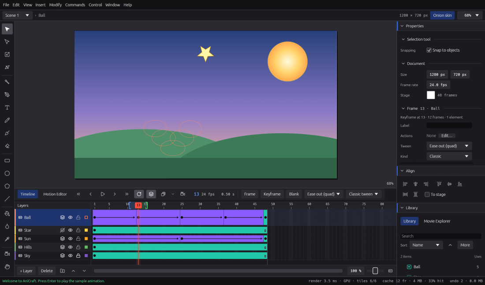

# The timeline

The timeline is where your animation happens: layers stack your artwork from front to back,
and frames lay it out in time. This chapter covers layers, frames and keyframes, playback,
onion skin and Edit Multiple Frames.

A note on keys: AniCraft uses **Ctrl** on Windows and Linux and **⌘** (Command) on macOS, and
**Alt** is **⌥** (Option) on macOS. So **Ctrl+Alt+C** is **⌥⌘C** on a Mac. Every shortcut
here is a default you can change in the shortcut editor (**F1**); see
[Preferences, shortcuts and accessibility](preferences-shortcuts-accessibility.md).

## A tour of the timeline

The timeline sits under the stage. From left to right, its header holds:

* the **Timeline** and **Motion Editor** tabs;
* the playback buttons: First frame, Previous frame, Play / Stop, Next frame, Last frame and
  Loop playback;
* the onion skin buttons and their options menu;
* the camera button;
* the current frame number, the frame rate and the time at the playhead;
* the **Insert frame**, **Insert keyframe** and **Insert blank keyframe** buttons (a frame, a
  filled dot and a hollow dot, each with a plus), and a tween menu.

Under the header, the layer list is on the left and the frame grid on the right, with the frame
ruler along the top. The bar at the bottom has buttons for new layers and folders, deleting and
moving layers, and, at its right end, the frame zoom and the **Frame View** menu.

If the header doesn't fit in a small window, scroll it sideways with **Shift** and the mouse
wheel.

## Layers

### Making and removing layers

* **New layer**: click **+ Layer** under the layer list, or choose **Insert › Timeline › New
  Layer**. It goes above the active layer.
* **Delete a layer**: select it and click the delete button under the list, or choose
  **Modify › Timeline › Delete Layer**. Undo brings it back.
* **Reorder layers**: use the up and down buttons under the list, or **Modify › Timeline › Move
  Layer Up** and **Move Layer Down**.
* **Rename a layer**: double-click its name, or right-click it and choose **Rename Layer**.

Clicking a layer's name makes it the active layer and selects its artwork, as you'd expect from
Animate. Right-click a layer for a menu with nearly everything in this section.

### Show, lock and outline

Each layer row has three toggles:

* the **eye** shows or hides the layer;
* the **lock** stops you from selecting or changing its artwork by accident;
* the **colour square** draws the layer as outlines in the layer's colour (**View as
  Outlines**).

Outlines are a working aid only. They show on the stage, but Test Movie and every export draw
the artwork as it really is.

### Layer colours

Every layer has a colour, used for its outlines and its bar on the timeline. Click the thin
colour chip on the left edge of a layer row to pick another: choose a swatch, type a hex value,
or click **More…** for any colour.

### Layer height

Right-click a layer and choose **Layer Height** › **100 %**, **200 %** or **300 %** to make its
row taller. This is handy for layers you work on a lot, or for seeing sound waveforms.

### Layer Properties

Double-click a layer's icon (or right-click it and choose **Properties…**, or choose **Modify ›
Timeline › Layer Properties**) to open the Layer Properties window. Here you can set, all at
once, the layer's name, whether it shows and is locked, its type (Normal, Mask, Masked, Guide
or Guided), its outline colour, outlines, onion skin and height. **OK** applies everything as
one undo step; **Cancel** changes nothing.

Layer Properties works on one layer at a time. Editing several layers at once isn't there yet.

### Folders

Folders keep big timelines tidy.

1. Click the folder button under the layer list, or choose **Insert › Timeline › New Folder**.
   The folder appears above the active layer.
2. Select a layer and use the up and down buttons to move it in under the folder. Moving a layer
   off either end of the folder takes it out again.
3. Click the folder's chevron to open or close it.

Hiding or locking a folder hides or locks everything inside it. Folders can nest, and a folder
moves with its contents. Deleting a folder deletes what's in it: AniCraft asks first, and undo
brings it all back.

### Special layer types

Some layers do a special job: **mask** layers, **guide** layers, the **camera** layer and
**armature** layers for bones. They are covered in
[Masks, guides, camera and bones](masks-guides-camera-bones.md).

## Frames and keyframes

A **keyframe** is a frame where the artwork changes. Ordinary frames after it hold that artwork
until the next keyframe; together they make a **frame span**. A **blank keyframe** is a keyframe
with nothing on it, so the layer is empty from there on.

| To do this | Key | Menu |
|---|---|---|
| Insert a frame (extend the span) | **F5** | **Insert › Timeline › Frame** |
| Remove a frame | **Shift+F5** | **Insert › Timeline › Remove Frame** |
| Insert a keyframe (copy of the artwork) | **F6** | **Insert › Timeline › Keyframe** |
| Insert a blank keyframe | **F7** | **Insert › Timeline › Blank Keyframe** |
| Turn a keyframe back into a plain frame | **Shift+F6** | **Insert › Timeline › Clear Keyframe** |

The **Insert frame**, **Insert keyframe** and **Insert blank keyframe** buttons in the timeline
header do the same, and so does the right-click menu on the frames.

As in Animate, the keys keep you moving along the timeline:

* **F5** moves the playhead onto the frame it adds, so holding it down walks along the timeline.
* **F6** or **F7** on a frame that is already a keyframe adds the new keyframe on the *next*
  frame and moves there, so you can draw, press **F6**, draw again, and so on. On any other
  frame they key the frame you're on.
* With no frames selected (for example after scrubbing the playhead), **F5** adds a frame on
  every layer that has frames at or after the playhead, so the layers stay in step. Layers that
  end before the playhead are left alone. When no layer reaches the playhead, it lengthens the
  layer you're on up to it.
* With a frame selected, the keys act on that frame's layer, and the selection moves with the
  playhead.

An empty frame shows a hint in **Properties › Frame**: press **F7** to start drawing there.

### Selecting frames

* Click a frame to select it and move the playhead there.
* **Shift**-click, or drag across frames, to select a range. A selection can span several
  layers.
* **Ctrl+Alt+A** selects every frame.

The frame keys, the header buttons and the right-click menu all act on the whole selection.
Removing or clearing frames that hold artwork asks first.

### Moving keyframes and resizing spans

* **Move keyframes**: drag selected keyframes left or right in time, or up and down onto other
  layers. An outline shows where they will land. Keys they land on are replaced, and the source
  keeps empty frames, as in Animate.
* **Change a span's length**: drag the end of a span. The pointer turns into a resize cursor,
  and a label shows the length in frames and seconds. Later frames move with it.

Each drag is one undo step.

### Cut, copy and paste frames

| Command | Key |
|---|---|
| **Edit › Timeline › Cut Frames** | **Ctrl+Alt+X** |
| **Edit › Timeline › Copy Frames** | **Ctrl+Alt+C** |
| **Edit › Timeline › Paste Frames** | **Ctrl+Alt+V** |

After you click in the timeline, plain **Ctrl+X**, **Ctrl+C** and **Ctrl+V** work on frames
too. Pasting inserts the frames, as in Animate. Frames copied from several layers paste onto
the layers below the one you paste into, and AniCraft creates any layers that are missing.
Symbols travel with the frames, even into another document.

### Frame labels

Give a keyframe a name in **Properties › Frame › Label**. Labels show on the timeline, and
actions and scripts can jump to them by name, which keeps working when you move frames around.
See [Interactivity](interactivity.md).

## Playback

* Press **Enter**, click the Play button, or choose **Control › Play** to play. Press **Enter**
  again to stop.
* Turn on **Loop playback** (the loop button, or **Control › Loop Playback**) to play round and
  round.
* Click or drag on the frame ruler to scrub.
* Step with **.** (next frame) and **,** (previous frame), and jump with **Home** (first frame)
  and **End** (last frame). **Shift+,** and **Shift+.** also go to the first and last frame.

To see the movie with its buttons and scripts working, use **Control › Test Movie**
(**Ctrl+Enter**); see [Interactivity](interactivity.md).

### Frame rate

The header shows the frame rate. To change it, click an empty part of the stage so nothing is
selected, then set **Properties › Document › Frame rate** (1 to 120 fps; fractional rates such
as 29.97 work too).

### Zooming the frames

Hold **Ctrl** and use the mouse wheel over the frames to zoom in and out around the pointer, or
use the frame zoom slider at the right end of the bottom bar. The **Frame View** menu beside it
picks a frame width (**Tiny**, **Small**, **Normal**, **Medium** or **Large**) and has **Short**
for thinner rows. The wheel scrolls the layers; **Shift** and the wheel scroll the frames.

## Onion skin

Onion skin shows the frames around the playhead faintly, so you can draw each pose in relation to
the last.

Turn it on with the onion skin button in the timeline header, **View › Onion Skin**, or
**Alt+Shift+O**. Frames before the playhead are tinted blue, frames after it green, and each
fades the farther it is from the playhead.

### Choosing which frames show

Two brackets on the frame ruler mark the frames onion skin shows. Drag the start and end
markers to show more or fewer frames. By default you see two frames on each side.

### Onion skin options

Open the options from the arrow next to the onion buttons, a right-click on the frame ruler, or
**View › Onion Skin Options**:

| Option | What it does |
|---|---|
| **Outlines** | Draws onion frames as outlines only. |
| **Keyframes Only** | Shows only the frames where a keyframe starts. |
| **Always Show Markers** | Keeps the markers on the ruler when onion skin is off. |
| **Anchor Markers** | Keeps the markers on their frames instead of moving with the playhead. |
| **Onion 2**, **Onion 5**, **Onion All** | Quick ranges: 2 or 5 frames each side, or every frame. |
| **Tint** | Colours frames before and after the playhead; turn it off to see their own colours. |
| **Fade by Distance** | Makes farther frames fainter. |
| **Before** / **After** colour | Pick your own tints; **Reset** goes back to the theme's. |

AniCraft remembers your choices. As in Animate, locked layers are left out of onion skin.

### Onion skin per layer

Each layer row has its own onion toggle. Click it to leave that layer out (it then shows only
its playhead frame). **Alt**-click it to onion-skin that layer only; **Alt**-click again to turn
every layer back on. You can also set it in the layer's right-click menu or Layer Properties.
Folders don't have their own toggle yet.

When you edit a symbol in place, onion skin works on the symbol's own timeline, and the parent
timeline's frames show dimmed around it.

## Edit Multiple Frames

Edit Multiple Frames lets you change artwork on several keyframes at once: shift a whole walk
cycle, or line up every pose.

1. Click the **Edit Multiple Frames** button next to the onion skin button, or choose **View ›
   Edit Multiple Frames**.
2. Drag the markers on the frame ruler to cover the keyframes you want. They show at full
   strength.
3. Select artwork on all of them: click, **Shift**-click, drag a marquee, or **Ctrl+A**.
4. Change it. Each change is one undo step.

While it's on, you can:

* drag the selection, or nudge it with the arrow keys;
* use the **Free Transform** tool: one box goes round the selection on every keyframe, and
  scaling and rotating happen about one shared pivot;
* **Align** it (**Ctrl+Alt+1** to **Ctrl+Alt+6**, to the stage too), rotate it 90° or flip it;
* **Cut**, **Copy**, **Paste** (onto the current frame), **Paste in Place** (back keyframe by
  keyframe, or a one-frame copy onto every keyframe between the markers) and **Clear** it.

A motion tween's path moves with its object. Merge-drawing shapes merge again on their own
keyframe, so drawings stay connected. It also works inside a symbol you're editing in place.

Not there yet: Duplicate, Distribute, Arrange and recolouring across keyframes, scaling a motion
tween's object on several frames, and dragging the shared pivot.

## Scenes

A movie can have several scenes, each with its own timeline, played one after another.

* Add one with **Insert › Scene**.
* Switch scenes from the scene menu at the top left of the stage, or with **Shift+Page Up** and
  **Shift+Page Down**.
* Duplicate, rename, reorder and delete them under **Modify › Scene**. Deleting a scene with
  artwork asks first, and undo brings it back.

## Dropping files on the timeline

You can drag files from your desktop straight onto a frame:

* a **sound** goes onto that frame's keyframe;
* an **image** or **SVG** drawing goes onto that layer at that frame, in a new keyframe if
  needed.

A highlight shows the cell it will land in, and the drop is one undo step. Locked layers,
folders and the camera layer won't take a drop, and AniCraft tells you why. See
[Images and sound](images-and-sound.md) for more.

## Next steps

* Make things move between keyframes: [Tweens](tweens.md).
* Masks, motion guides, the camera and bones:
  [Masks, guides, camera and bones](masks-guides-camera-bones.md).
* Every shortcut in one place: [Keyboard shortcuts](reference/shortcuts.md).
