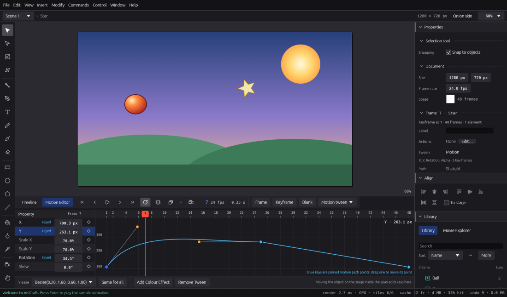

# Tweens

A tween fills in the frames between two poses, so you draw the key moments and AniCraft does the
in-betweens. This chapter covers the three kinds of tween, easing, shape hints, the Motion
Editor and motion paths.

A note on keys: AniCraft uses **Ctrl** on Windows and Linux and **⌘** (Command) on macOS, and
**Alt** is **⌥** (Option) on macOS. So **Ctrl+Shift+H** is **⇧⌘H** on a Mac.

## Which tween should I use?

| Tween | Best for | On the timeline |
|---|---|---|
| **Classic tween** | Moving, scaling, rotating and fading an object between two keyframes. | Violet span |
| **Shape tween** | Morphing one shape into another: a square into a star, a blob into a splash. | Amber span |
| **Motion tween** | Animating an object property by property, with its own curves and a path you can bend. | Sky-blue span |

All three show the same everywhere: on the stage, in Test Movie and in every export.

You can create any of them from the **Insert** menu, from the right-click menu on the frames,
from the tween menu in the timeline header, or from **Properties › Frame**.

## Classic tweens

A classic tween runs from one keyframe to the next.

1. Put your object on a keyframe. A symbol instance works best (**F8** converts a selection to
   a symbol).
2. Go to a later frame and press **F6** to make a keyframe there.
3. Move, scale, rotate or fade the object on the new keyframe.
4. Click a frame in the span between them and choose **Insert › Create Classic Tween**.

Play it with **Enter**. If you change the object on a frame in the middle of a classic tween,
AniCraft adds a keyframe there for you.

To take a tween away, choose **Insert › Remove Tween**. The frames keep the first keyframe's
artwork.

## Easing

Easing makes motion speed up or slow down instead of moving at one steady pace. Pick an ease
for a classic or shape tween in any of these places:

* the **Easing** menu in the timeline header (it appears while the playhead is in a tween);
* **Properties › Frame › Tween**, which also shows a small picture of the curve;
* the right-click menu on the span, under **Ease**.

The presets are **Linear**, **Ease in (quad)**, **Ease out (quad)**, **Ease in-out (quad)**,
**Ease in (cubic)**, **Ease out (cubic)**, **Ease in-out (cubic)** and **Smooth (bezier)**. An
"in" ease starts slowly, an "out" ease ends slowly, and "in-out" does both.

Motion tweens have their own, finer easing per property: see [The Motion
Editor](#the-motion-editor).

## Shape tweens

A shape tween morphs the shapes on one keyframe into the shapes on the next, even when they're
built quite differently (one blob into two, for example).

1. Draw a shape on a keyframe. Use plain shapes, not symbols.
2. Make a blank keyframe later on (**F7**) and draw a different shape there.
3. Click a frame between them and choose **Insert › Create Shape Tween**.

Fills, strokes, gradients and stroke widths blend as the shape changes. To switch a span between
a classic and a shape tween, use the tween menu in the timeline header or **Properties › Frame ›
Kind**; the easing is kept.

### Shape hints

Sometimes a morph twists or folds in a way you don't want. Shape hints tell AniCraft which
point on the first shape becomes which point on the last.

1. Put the playhead on the shape tween's first keyframe.
2. Choose **Modify › Shape › Add Shape Hint** (**Ctrl+Shift+H**). A lettered marker, starting
   at **a**, appears at the centre of the shape.
3. Drag the marker onto an edge of the shape. It snaps to the nearest edge.
4. Go to the last keyframe and drag the same letter onto the matching edge there.
5. Add more hints the same way, up to **z**, working round the shape in order.

The colours tell you where each hint stands: rose until it's placed, amber once it's placed on
the first keyframe, and mint on the last. Right-click a hint to remove it, or choose **Modify ›
Shape › Remove All Hints**. **Ctrl+Z** undoes either.

Not there yet: a **View** menu switch to hide the hints, and hints inside a symbol you're editing
in place.

## Motion tweens

A motion tween animates one object, and gives every property its own timing. There are no
keyframes in the middle of the span: instead, each property (X, Y, scale, rotation, skew, alpha
and the colour effects) has **property keyframes** wherever you need them.

### Creating a motion tween

1. Place an object on a keyframe.
2. With the playhead on that span, choose **Insert › Create Motion Tween**.

If the keyframe holds several objects, they become one graphic symbol first. If the span is only
one frame long, it grows to a second's worth of frames. Both work as they do in Animate.

### Adding property keyframes

Move the playhead to any frame inside the span and change the object: move it, scale it, rotate
it or fade it. AniCraft keys just the properties you changed, at that frame. A diamond on the
span marks each frame with property keyframes.

Press **F6** inside the span to key every property at once.

## The Motion Editor

The Motion Editor shows a motion tween's properties as curves you can shape.

Open it with the **Motion Editor** tab beside **Timeline**, **Window › Motion Editor**, or a
double-click on a motion span.

On the left is the list of properties, with each one's value at the playhead.

* Drag a value to change it and key it at the playhead.
* Click the diamond (◇) next to a property to add a keyframe there, or to remove the one that's
  there.
* **Add Colour Effect** lists a colour effect style's properties (such as brightness or tint) so
  you can key them.

On the right is the selected property's curve:

* drag a key up or down to change its value;
* drag the two handles of a segment to shape its ease (overshoot is allowed, for a bounce or a
  wind-up);
* double-click to add a key;
* click to move the playhead.

Under **Ease**, pick a preset for the segment at the playhead. **Same for all** gives every
property's segment there the same ease. Each drag is one undo step.

**Remove Tween** takes the motion tween away, leaving the object as it is on the span's first
frame.

Not there yet: moving keys in time (retiming), and stretching keys when you resize the span.

## Motion paths

When you select a motion tween's object, or a frame of its span, the stage shows the path the
object travels, with a dot for every frame. A straight path appears as soon as the object
moves.

### Bending the path

* With the **Selection** tool (**V**), drag the path to bend it, or drag an end to change where
  the motion starts or finishes.
* With the **Subselection** tool (**A**), drag the path's points and their handles. Smooth points
  stay smooth; hold **Alt** to move one handle on its own.

The object follows the path at the pace its X and Y curves set, so your eases carry over.

### Adding and removing path points

* With the Subselection tool, double-click the path to add a point. Nothing moves when you do.
* With the **Pen** tool (**P**), **Alt**-click the path to add a point.
* **Shift**-click to select several points, then press **Delete** to remove them. The path refits
  through the rest. The two ends always stay, because that's where the motion starts and ends.
* Right-click a point for **Make Smooth**, **Make Corner** and **Straighten Path**.

### Moving the whole path

**Ctrl**-drag the path or its object to move the whole path, or type a new position in
**Properties › Frame › Path start**. The timing stays exactly as it was.

### Orient to path and Straighten

In **Properties › Frame**, turn on **Orient to path** to make the object turn as the path turns,
like a car following a road. **Straighten** goes back to a straight path.

### Points pinned to frames

When you move the object at a frame in the middle of the span, the path gets a point there that
is **pinned** to that frame: the object passes exactly through that point on that frame, however
else you reshape the path. After the last pinned point, the path carries on to the new place.

* Pinned points show on the stage as diamonds with their frame number. You can drag them with the
  Selection tool.
* With the Subselection tool, right-click any point and choose **Pin to Frame** to pin it to the
  playhead's frame, or **Unpin from Frame** to let it shape the path only.
* **Properties › Frame** has **Pin Here** and **Unpin** for the playhead's frame.
* Pressing **F6** inside the span pins a point where the object is.

The path's two ends are always pinned. In the Motion Editor, a pinned frame's X and Y keys are
blue; dragging one moves its point. On the timeline, pinned frames have a larger diamond.

Not there yet: retiming a pin by dragging its key, two pins on one point, selecting path points
with a marquee, and nudging or transforming a whole path.

## Following a drawn path with a classic tween

Classic tweens can follow a path too, using a motion guide layer. See
[Masks, guides, camera and bones](masks-guides-camera-bones.md).

## Tweens in Animate files

When you open an Animate document, its classic tweens (with their eases), shape tweens and shape
hints come across. Motion tweens and their motion paths don't come across from Animate files
yet. See [Opening Animate files](opening-animate-files.md).

## Next steps

* Layers, keyframes and onion skin: [The timeline](timeline.md).
* Make your movie respond to clicks: [Interactivity](interactivity.md).
