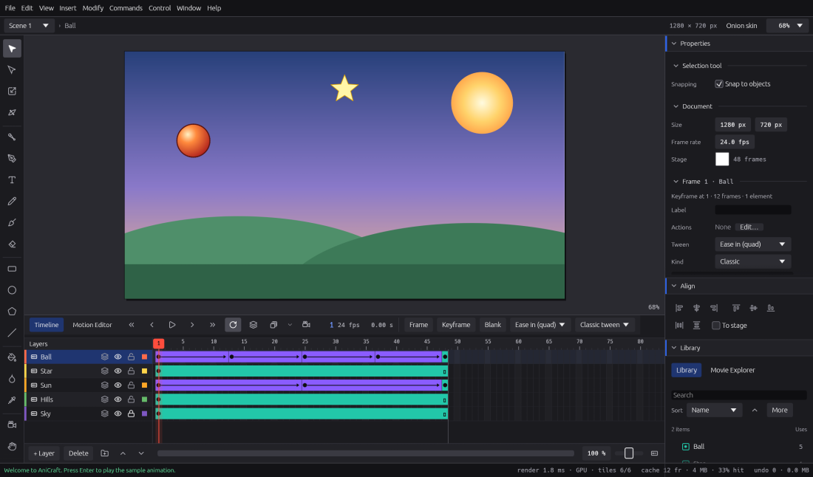

# The workspace

This chapter is a tour of the AniCraft window: what each panel is for, how to find any
command, how to move around the stage, and how to work with scenes. If you know Animate,
most of it will be where you expect.

Shortcuts are written the Windows and Linux way. On macOS, use ⌘ (Command) for Ctrl and ⌥
(Option) for Alt: **Ctrl+K** is **⌘K**.

## The window layout

AniCraft opens with the **Essentials** workspace: the panels docked as below. You can move
every panel (see [Arranging panels and workspaces](#arranging-panels-and-workspaces)).

| Area | Where | What it's for |
|---|---|---|
| Menu bar | top | Every command, grouped as in Animate: File, Edit, View, Insert, Modify, Commands, Control, Window, Help. On macOS there's also the AniCraft menu, with About, Settings… and Quit. |
| Edit bar | above the stage | The scene menu, the path to the symbol you're editing, the active layer, the stage size, an **Onion skin** switch, the **Clip content outside the stage** button and the zoom menu. |
| Tools | left | The drawing and editing tools, the **Snap to Objects** magnet, and the current fill and stroke colours. Drag the dotted grip at the top to move them. |
| Stage | middle | Your artwork. The stage rectangle is what the movie shows. You can draw on the grey area around it too. |
| Timeline and Motion Editor | bottom | Layers, frames and playback. The **Motion Editor** tab beside it shows a motion tween's property curves. |
| Properties | right, top | Settings for the current tool, then for what's selected, the document and the current frame. |
| Align | right | Align and distribute buttons. |
| Library and Movie Explorer | right, below Align | Two tabs sharing one space: your symbols, images and sounds, and a tree of everything in the movie. |
| History | right, bottom | Every undo step. Click one to go back to it. |
| Status bar | bottom edge | Hints and messages, the pointer's position, autosave time and how much undo history is kept. |

Click the arrow at the left of a panel group's header to fold the group away and give the
others room. Drag the edge between the stage and a dock, or the line between two panel groups,
to resize them.

Some things open in windows of their own, which stay open while you work:

* **Edit › Find and Replace** (**Ctrl+F**).
* **File › Publish Settings…** (**Ctrl+Shift+F12**).
* **Control › Test Movie** (**Ctrl+Enter**) plays your movie in its own window.

**Window › Actions** (**F9**) opens the Actions panel floating in a window of its own (see
[Interactivity](interactivity.md)); you can dock it like any other panel.

## Arranging panels and workspaces

Every panel can go anywhere: Tools, Properties, Align, Colour, Swatches, Library, Movie
Explorer, History, Layer Depth, Timeline, Motion Editor, Actions and Output.

* **Move a panel** by dragging its tab. While you drag, a blue area shows where it will go:
  * onto another group's header, or onto a floating window: it joins that group or window as
    a tab;
  * onto the top or bottom half of a group (left or right half below and above the stage): a
    group of its own just there;
  * near an edge of the stage: a dock on that side. This is how you put the **timeline above
    the stage**: drag its tab to the top of the stage;
  * anywhere else: it floats in a window of its own.

  Press **Esc** while dragging to leave everything as it was.
* **Use the panel menu** (the ☰ button at the right of each group's header, or right-click a
  tab) to do the same without dragging: dock a panel on any side, float it, **Stack With**
  another group or floating window, fold its group, collapse its dock to icons, close it or
  close the whole tab group. The menu works from the keyboard too: **Tab** to the ☰ button and
  press **Enter**.
* **Move the tools** by dragging the dotted grip at the top of the tools bar (or click it for
  its menu). Near an edge of the stage they become a slim bar on that side, above or below
  the stage as a row; dropped on a group they become a tab there, laid out in as many columns
  as fit; anywhere else they float.
* **Floating windows** have their own window on the desktop, which you can put on another
  screen. They can hold **several panels as tabs**: drag a tab onto a floating window, or use
  **Stack With**. Drag a tab out of the window to move just that panel; drag the window's
  dotted grip (or, inside the AniCraft window, its title bar) to move **the whole window back
  into a dock**, with the same blue drop areas. **Dock** puts its panels back where they came
  from. Your shortcuts with Ctrl or Alt (Undo, Save, Test Movie…) still work there. Where a
  system can't open another window (the web version), a floating window floats inside the
  AniCraft window instead.
* **Collapse a dock to icons** with the » button on its first group's header (or **Collapse
  the Dock to Icons** in the panel menu). The dock shrinks to a strip of panel icons, so the
  stage gets the room; hold the pointer over an icon for the panel's name. Click an icon to
  open its panel over the stage; **Esc** or a click anywhere else closes it again. The button
  at the top of the strip expands the dock as it was. **Window** opens a collapsed panel the
  same way.
* **Close a panel** from its menu, or from its floating window. **Window** lists every panel,
  ticked while it's on screen; choose one to bring it forward (it reopens where it was), or
  choose a ticked one to close it.

Panels work at any width. When a dock is narrow, a setting whose value doesn't fit beside its
name goes under it, and lists and fields get narrower, so nothing is cut off at the edge.

**Ctrl+F6** moves the keyboard from panel to panel in the order they are docked (the stage,
the docks above, below and to the right and left of it, floating panels inside the window,
then the tools). In a dock collapsed to icons it lands on the first icon, or on the panel open
over the stage. Panels in a window of their own have their own keyboard.

### Workspaces

A workspace is a named arrangement of the panels. **Window › Workspace** has three:

| Workspace | What it's for |
|---|---|
| **Essentials** | The layout above. |
| **Animator** | A tall timeline, with the Output and History beside it, and a slim right dock. |
| **Designer** | A wide Properties panel with Colour and Align under it, and a short timeline. |

Each workspace remembers how you changed it, until you choose **Window › Workspace › Reset**.
**Save Workspace…** keeps the current arrangement under a name of your own; it's listed with
the others, and Reset brings it back as you saved it. **Manage Workspaces…** lists them all:
rename or delete your own (delete asks with a second click, as it can't be undone), and reset
any that changed. The built-in ones can be reset but not renamed or deleted. Your workspaces
and where every panel is are kept in your preferences, so AniCraft opens the way you left it.

### Properties

Properties changes with what you're doing, from top to bottom:

* **The tool's options** while a drawing tool is in your hand, such as the Rectangle's fill,
  stroke and corner radius, or the Brush's size and shape.
* **The selection**: position, scale, rotation, colour effect and more. With several things
  selected, the title says how many ("6 elements on 4 layers"). A row whose value differs
  between them says **mixed**, and changing it sets them all.
* **Document**, when nothing is selected: the stage size, the frame rate and the stage
  colour. **Modify › Document Settings** changes them too.
* **Frame**: the keyframe at the playhead, its label, its tween and its sound.

Changes show on the stage as you drag a value, and each drag is a single undo step.

### Colour and Output

**Colour** sets the stroke and fill colours new shapes and text use; with something selected,
a change also recolours the selection (one undo step). **Swap** exchanges the two, and **Black
and White** sets a black stroke and a white fill. **Output** shows what the running Test Movie
writes (its `trace` actions, frame-script logs and anything that couldn't run), and keeps the
last run's lines after Test Movie closes.

### The Window menu

The **Window** menu has the workspaces, every panel (**Actions** is **F9**, **Movie Explorer**
**Alt+F3**), the **Brush Library** and **Onion Skin**.

## The command palette

Press **Ctrl+K** (or **Ctrl+Shift+P**) to open the command palette, or choose **Help ›
Command Palette…**. Type part of a name, such as "key" or "symbol", and the palette lists the
matching commands, tools and settings with their shortcuts. Use the arrow keys to pick one
and **Enter** to run it. Installed plug-ins show up here too.

It's the fastest way to reach anything when you don't remember which menu it lives in.

For a list of every shortcut, choose **Help › Keyboard Shortcuts** (**F1**). That sheet also
lets you change them (see [Preferences, shortcuts and accessibility](preferences-shortcuts-accessibility.md)).

## Moving around the stage

### Panning

* Hold **Space** and drag, with any tool.
* Or pick the **Hand** tool (**H**) and drag.
* Or scroll with the mouse wheel or trackpad: up and down, and sideways with a trackpad.

### Zooming

| To | Do this |
|---|---|
| Zoom in or out around the pointer | **Ctrl** + mouse wheel, or pinch on a trackpad |
| Zoom in | **View › Zoom In** (**Ctrl+=**), or click with the **Zoom** tool (**Z**) |
| Zoom out | **View › Zoom Out** (**Ctrl+-**), or **Alt**-click with the Zoom tool |
| Fit the whole stage in the window | **View › Fit in Window** (**Ctrl+0**, or **Ctrl+2**) |
| See the stage at actual size | **View › 100%** (**Ctrl+1**) |
| Jump to a set zoom | the zoom menu at the right of the edit bar: Fit in window, 25 % to 800 % |

### The pasteboard

The grey area around the stage is the **pasteboard**. You can draw, paste and park artwork
there, as in Animate: notes for yourself, spare drawings, or a background wider than the stage
that a tween slides across. Only what is on the stage shows in Test Movie and in exports.

To hide everything outside the stage while you work, click **Clip content outside the stage**
(the frame with crop marks, left of the zoom menu), or choose **View › Clip Content Outside the
Stage**. The artwork is still there; click again to see it.

### Rulers, grids and guides

**View › Rulers** (**Ctrl+Alt+Shift+R**) puts rulers along the top and left of the stage, in
pixels from its top-left corner. Drag from a ruler to make a guide. **View › Grid** shows a
grid and **View › Guides** shows, locks and edits guides; all of them snap. See
[Drawing](drawing.md#rulers-grid-and-guides).

* The status bar shows the pointer's position on the stage (**x** and **y**, in pixels).
* **Properties** shows and sets the exact position and size of what's selected.
* The **Align** panel lines things up with each other or with the stage.
* Templates put their layout guides on a guide layer, which you can draw on yourself:
  anything on a guide layer shows while you work but never exports (see
  [Timeline](timeline.md)).

### Snapping

**Snap to Objects** is on by default. When you drag points or a selection, or draw with the
Line, Rectangle, Oval, PolyStar or Pen tools, points snap to nearby corners, ends, lines and
fill edges within 10 screen pixels, at any zoom. A small ring shows where the point will
snap. To turn it on or off:

* click the magnet below the tools,
* choose **View › Snapping › Snap to Objects**, or
* press **Ctrl+Shift+/**.

Arrow keys nudge the selection by one screen pixel, or ten with **Shift**.

## How the stage is drawn

### Stage rendering modes

**View › Stage Rendering** sets when edits appear on the stage. The same setting is in
**Preferences › Stage › Rendering**.

* **Auto** (the default): edits show immediately. On very heavy scenes, the stage draws in
  the background and shows an outline of what you're dragging until it catches up.
* **Immediate**: every edit is drawn before the next frame. It reacts fastest, but very heavy
  scenes may stutter.
* **Background**: the stage always draws in the background. The window never waits, but the
  picture can trail a frame behind.

### Graphics card or CPU

AniCraft draws the stage on your graphics card by default, which is much faster on big stages
and busy scenes. The same menu, and **Preferences › Stage › Renderer**, offers:

* **Graphics card (GPU)**: the default.
* **CPU (reference)**: AniCraft's reference renderer. It's slower on large stages.

The picture is the same either way. If there's no graphics card that can do the job, or a
frame needs something the card can't draw, the CPU takes over for that moment. The status bar
says which one drew the stage (for example "render 3.1 ms · GPU"). Exports always use the CPU
renderer, so they're exactly the same on every computer. The web version always draws on the
CPU for now.

### Previewing through the camera

If your scene has a camera, choose **View › Preview Through Camera** to see the stage
exactly as the movie will frame it. While the preview is on you can't edit artwork. See
[Masks, guides, camera and bones](masks-guides-camera-bones.md).

## Scenes

A movie can be split into scenes that play one after another. Each scene has its own
timeline. Use the scene menu at the left of the edit bar to switch scenes and to manage them:

* **Insert › Scene** adds a new scene.
* **Modify › Scene** has **Duplicate Scene**, **Rename Scene**, **Delete Scene**, **Move
  Scene Earlier** and **Move Scene Later**.
* **Control › Previous Scene** (**Shift+Page Up**) and **Control › Next Scene**
  (**Shift+Page Down**) step between them.

Deleting a scene with artwork in it asks first, and undo brings it back. Animated GIFs, video
and PNG sequences export the whole movie, every scene in order. Single-frame exports use the
scene you're in.

## Finding things

### Find and Replace

**Edit › Find and Replace** (**Ctrl+F**) opens a window that stays open while you work. It
searches as you type. You can search for:

* **text**: in text fields, frame labels, layer names, instance names and frame scripts, with
  match case, whole word and regular expressions;
* **fonts**, **colours** (in fills, gradient stops, strokes and text);
* **symbols**, **sounds** and **bitmaps**.

Choose whether to search this scene and the symbols in it, or the whole document. Click a
result, or press **Find Next** (**F3**) or **Find Previous** (**Shift+F3**), to go there:
AniCraft switches to the scene and frame, opens the symbol if needed, and selects the item.

**Replace** replaces the current result and moves on to the next one. **Replace All** is a
single undo step, and asks first if it would change more than 100 places.

### The Movie Explorer

**Window › Movie Explorer** (**Alt+F3**) is a tab next to the Library. It shows your movie as
a tree: scenes, then layers, keyframes, and what's on them (instances, text, sounds, bitmaps
and scripts). Each instance opens to show what's inside its symbol. It can also list every
symbol in the Library.

Use the **Show** menu to choose what it lists, and the search box to keep only matching rows.
Double-click a row to go to it. Both Find and the Movie Explorer stay quick even on very large
movies.

## The status bar

The status bar along the bottom is worth a glance now and then:

* On the left, when nothing has just happened, it explains the tool in your hand ("Drag to
  draw a rectangle. Shift draws a square.").
* After an action, it says what happened, and often how to undo it ("Removed the script — Ctrl+Z
  to undo"). Problems show in red.
* On the right are the pointer's stage position, when autosave last ran, how long the stage
  took to draw and on what, and how many undo steps are kept.

## Undo and History

**Edit › Undo** (**Ctrl+Z**) and **Edit › Redo** (**Ctrl+Y**) work for everything that
changes your document, including Properties edits, timeline changes and Library changes. A
drag is always a single step. The **History** panel at the bottom of the dock lists the steps
by name. Click any step to jump back to it, and click a later (dimmed) one to go forward
again.

Undo history is kept in memory while the document is open. It isn't saved with the file.

## Right-click menus

Almost everything has a right-click menu: the stage and its artwork, timeline frames and
layers, Library items, motion paths and more. They offer the commands that make sense for
what you clicked, with the same names and shortcuts as the menu bar.
